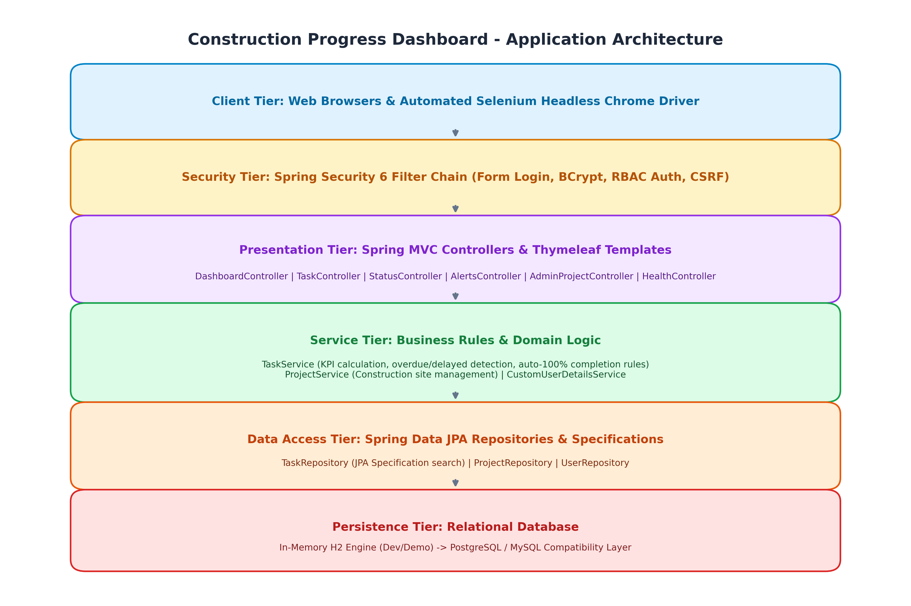
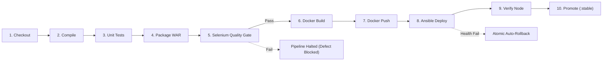

# Construction Progress Dashboard 🏗️

[](https://www.oracle.com/java/)
[](https://spring.io/projects/spring-boot)
[](https://www.docker.com/)
[](https://www.ansible.com/)
[](https://www.jenkins.io/)
[](https://github.com/ganesh-dahiphale/construction_project_dashboard/releases/tag/v1.1.0)
[](LICENSE)

A collaborative, enterprise-grade web platform and automated DevOps delivery ecosystem engineered for civil engineering, commercial building, and infrastructure project monitoring. Site engineers can rapidly log daily work activities, progress milestones, and site events, while project managers monitor high-level KPIs, searchable status indicators, progress drill-downs, and automated alerts for overdue tasks.

---

## 📋 Table of Contents

- [Project Overview & Key Features](#-project-overview--key-features)
- [Architecture Summary & Diagrams](#-architecture-summary--diagrams)
- [Technology Stack](#-technology-stack)
- [Repository Structure](#-repository-structure)
- [Role-Based Access & Default Credentials](#-role-based-access--default-credentials)
- [How to Run](#-how-to-run)
  - [1. Running Locally (Maven Wrapper)](#1-running-locally-maven-wrapper)
  - [2. Running via Docker Container](#2-running-via-docker-container)
  - [3. Running via Ansible Automation](#3-running-via-ansible-automation)
- [Continuous Delivery Pipeline (Jenkinsfile)](#-continuous-delivery-pipeline-jenkinsfile)
- [Documentation & Deliverables Index](#-documentation--deliverables-index)
- [Releases & Changelog](#-releases--changelog)

---

## 🚀 Project Overview & Key Features

On construction jobsites, lack of immediate visibility into daily activities leads to costly schedule overruns, miscommunication, and delayed reporting. The **Construction Progress Dashboard** provides a unified platform connecting field engineers to project management:

1. **Daily Task & Event Logging**: Field personnel log daily activities, materials utilized, and progress percentages (`/tasks/new`, `/tasks/{id}/edit`).
2. **Searchable Executive Dashboard**: Filterable and searchable dashboard displaying active jobs, milestones, and site locations (`/dashboard`).
3. **Automated KPI Summary Cards**: Real-time aggregation of total tasks, completed milestones, in-progress items, blocked tasks, and delayed activities.
4. **Status Drill-Down**: In-depth inspection view for individual site task categories (`/status`, `/status/{status}`).
5. **Overdue Task Alert Engine**: Automated flagging of tasks that exceed their target completion deadlines or stall without updates (`/alerts`).
6. **Project Boundary Administration**: Administrative portal for configuring construction site definitions and timelines (`/admin/projects`).
7. **Admin-Only Staff User Management**: Central administrative portal for registering staff (`ENGINEER` or `MANAGER`), updating profile information and roles, toggling employment job status (`ACTIVE`, `ON_LEAVE`, `INACTIVE`), resetting passwords, and permanently removing staff accounts with modal confirmation (`/admin/users`).
8. **Synthetic Health Monitoring**: RESTful actuator endpoint (`/health`) returning JSON health status for CI/CD gates and system monitoring.

---

## 🏛️ Architecture Summary & Diagrams

The system follows a classic enterprise multi-tier architecture containerized with Docker and supervised by systemd on Ubuntu.



### Key Architectural Characteristics
- **Web & Security Tier**: Spring MVC with Thymeleaf templates and Spring Security 6 filter chain with BCrypt password hashing and CSRF token protection.
- **Service Tier**: Domain logic enforcing auto-completion rules (marking a task `COMPLETED` automatically locks `percentComplete` to 100%) and real-time overdue detection against system time.
- **Data Access Tier**: Spring Data JPA specifications enabling dynamic multi-parameter search filtering without boilerplate SQL.
- **Deployment Topology**:
  - CI server (Jenkins) compiles code, runs unit tests, executes Selenium browser quality gates, builds multi-stage Docker images, and pushes to registry.
  - Ansible control node uses SSH to provision the target Ubuntu server (`cpd-target`), deploy containerized releases, verify node health, and execute automated rollback upon failure.

For complete architectural specifications, entity relationship diagrams (ERD), and deployment topologies, see [`docs/ARCHITECTURE.md`](docs/ARCHITECTURE.md).

---

## 🛠️ Technology Stack

| Domain | Technology / Component | Version / Details |
|---|---|---|
| **Backend Framework** | Java / Spring Boot | Java 17 LTS, Spring Boot 3.3.4 (Jakarta EE 10) |
| **Security & Auth** | Spring Security 6 | BCrypt (strength 10), Form Login, RBAC, CSRF Synchronizer Token |
| **Frontend & UI** | Thymeleaf & Bootstrap | Server-side HTML5 templates, Bootstrap 5.3, Bootstrap Icons |
| **Database & ORM** | Spring Data JPA / Hibernate 6 | In-memory H2 (Dev profile), PostgreSQL/MySQL compatible |
| **Build & Packaging** | Apache Maven / Maven Wrapper | Maven 3.9+, WAR packaging (`dashboard.war`) |
| **Automated Testing** | JUnit 5 & Selenium WebDriver | JUnit 5 Jupiter, MockMvc, Selenium 4.x Headless Chrome |
| **Containerization** | Docker Engine CE | Multi-stage Dockerfile, Eclipse Temurin 17 JRE, non-root user |
| **CI / CD Pipeline** | Jenkins Automation Server | Declarative `Jenkinsfile`, 10 stages, automated quality gates |
| **Configuration Management**| Ansible / OpenSSH | `ansible-core 2.20.1`, 6 modular roles, systemd supervisor, UFW |
| **Operating System** | Ubuntu Linux | Target Node: Ubuntu 26.04.1 LTS (systemd 259) |

---

## 📂 Repository Structure

```text
├── .mvn/wrapper/                  # Maven wrapper configuration and JAR
├── Jenkinsfile                    # Declarative CI/CD pipeline definition (10 stages)
├── Dockerfile                     # Multi-stage production container definition
├── pom.xml                        # Maven project object model and dependencies
├── mvnw / mvnw.cmd                # Maven wrapper executables (Linux / Windows)
├── ansible/                       # Ansible configuration management ecosystem
│   ├── ansible.cfg                # Ansible configuration (roles path, SSH settings)
│   ├── group_vars/app_servers.yml # Environment and host variables
│   ├── inventory/hosts.yml        # Target node inventory (cpd-target-node)
│   ├── playbooks/                 # Playbooks (provision, healthcheck, rollback, status)
│   └── roles/                     # Modular roles (common, docker, app_user, app_dirs, firewall, app_config, deploy)
├── docs/                          # Comprehensive technical documentation
│   ├── ARCHITECTURE.md            # System architecture, topology, ERD, and security
│   ├── TROUBLESHOOTING.md         # Operational knowledge base (Weeks 4-15)
│   ├── LIMITATIONS_AND_FUTURE.md  # Known limitations & prioritized future roadmap
│   ├── DEMO_SCRIPT.md             # 10-minute live demonstration runbook
│   ├── VIVA_PREP.md               # 50 oral examination questions and answers
│   ├── EVIDENCE_INDEX.md          # Master matrix linking issues, PRs, and builds
│   ├── images/                    # Architectural diagram PNG exports
│   └── evidence/                  # Weekly evidence logs (week6 through week15)
├── scripts/                       # Deployment and verification automation scripts
│   ├── deploy-node.ps1            # Workstation PowerShell deployment runner
│   └── deploy-node.sh             # Linux / Bash deployment runner
└── src/
    ├── main/                      # Application source code (Java & Thymeleaf)
    └── test/                      # Unit, integration, security, and Selenium E2E tests
```

---

## 🔐 Role-Based Access & Default Credentials

The platform enforces strict Role-Based Access Control (RBAC) via Spring Security URL rules and method-level security (`@PreAuthorize`):

### Access Control Matrix

| Role | Accessible Views & Endpoints | User Management Access | Allowed Actions |
|---|---|---|---|
| **`ADMIN`** | `/admin/users/**`, `/admin/projects/**`, `/dashboard`, `/status/**`, `/alerts`, `/tasks/**` | **Full Management** | Register engineers/managers, toggle status, reset passwords, edit profiles, delete accounts. Protected from self-deletion/demotion. |
| **`MANAGER`** | `/dashboard`, `/status/**`, `/alerts`, `/tasks/**` | **None (HTTP 403)** | Monitor executive metrics, review delays, inspect category drill-downs, update task assignments. |
| **`ENGINEER`** | `/tasks/**` | **None (HTTP 403)** | Log daily progress, update completion percentages, add execution remarks. |
| **`Anonymous`** | `/login`, `/register`, `/health`, static assets | **Redirected to `/login`** | Authenticate or view synthetic health endpoint. |

### Employment Status & Login Authorization
- **`ACTIVE`**: User account is authorized to log in and access permitted system views.
- **`ON_LEAVE` / `INACTIVE`**: User account is prevented from authenticating (`UserDetails.enabled = false`). Attempting to log in displays `"Account is inactive or on leave"`. Transitioning an account to `INACTIVE` or `ON_LEAVE` immediately invalidates any active HTTP sessions via `SessionRegistry`.

### Persistent File-Based Storage & Volume Mounts
The application uses a persistent file-based H2 database by default (`jdbc:h2:file:./data/dashboard;AUTO_SERVER=false`):
- **Local Dev**: Saved to `./data/dashboard.mv.db`.
- **Docker Container**: Persisted on named volume `construction-dashboard-data` mounted at `/app/data`.
- **Ansible Deployment**: Mounted from host directory `/opt/construction-dashboard/data:/app/data` under dedicated `appdeploy` ownership.
- **Idempotent Seed Runner**: `DataInitializer` seeds accounts only when not already present, guaranteeing that all admin-created users, modified roles, and task records survive restarts and redeployments.

### Development Seed Accounts (`dev` Profile)

| Role | Username | Default Password | Environment Override Variable |
|---|---|---|---|
| **Administrator** | `admin` | `admin123` | `DEV_ADMIN_PASSWORD` |
| **Project Manager** | `manager` | `manager123` | `DEV_MANAGER_PASSWORD` |
| **Site Engineer** | `engineer` | `engineer123` | `DEV_ENGINEER_PASSWORD` |

---

## 💻 How to Run

### 1. Running Locally (Maven Wrapper)

Requires Java 17+ installed.

```bash
# Clone the repository
git clone https://github.com/ganesh-dahiphale/construction_project_dashboard.git
cd construction_project_dashboard

# Run unit tests
./mvnw clean test

# Run application locally (port 8080)
./mvnw spring-boot:run -Dspring-boot.run.profiles=dev

# Access in browser: http://localhost:8080/login
```

To run the automated headless Selenium E2E test suite locally:
```bash
./mvnw -B -Pselenium test -Dheadless=true
```

---

### 2. Running via Docker Container

Requires Docker Desktop or Docker Engine running.

```bash
# 1. Build the multi-stage Docker image
docker build -t construction-dashboard:1.1.0 .

# 2. Run container mapped to host port 8082
docker run -d --name dashboard-app -p 8082:8080 -e SPRING_PROFILES_ACTIVE=dev construction-dashboard:1.1.0

# 3. Verify health probe
curl http://localhost:8082/health
# Response: {"status":"UP"}

# 4. View container logs
docker logs -f dashboard-app

# 5. Stop and clean up
docker stop dashboard-app && docker rm dashboard-app
```

---

### 3. Running via Ansible Automation

Provisions a target Ubuntu host and deploys the container supervised by systemd.

```bash
# 1. Verify SSH connectivity to target node
ANSIBLE_ROLES_PATH=ansible/roles ansible app_servers -i ansible/inventory/hosts.yml -m ping

# 2. Execute end-to-end server provisioning & container deployment
ANSIBLE_ROLES_PATH=ansible/roles ansible-playbook -i ansible/inventory/hosts.yml ansible/playbooks/provision.yml -e release_tag=1.1.0

# 3. Verify target node health
ANSIBLE_ROLES_PATH=ansible/roles ansible-playbook -i ansible/inventory/hosts.yml ansible/playbooks/healthcheck.yml

# 4. Audit active release state on target
ANSIBLE_ROLES_PATH=ansible/roles ansible-playbook -i ansible/inventory/hosts.yml ansible/playbooks/status.yml
```

---

## 🔄 Continuous Delivery Pipeline (Jenkinsfile)

The repository includes a production-ready, declarative pipeline (`Jenkinsfile`) that automates the entire delivery lifecycle:



### Pipeline Guarantees
- **Automated Quality Gate**: Runs 3 Selenium browser journeys against headless Chrome. If any UI assertion or workflow fails, the pipeline halts immediately, preventing container build or deployment.
- **Traceable Tagging**: Images are uniquely identified via `<version>-b<build>-<sha>`.
- **Atomic Rollback**: If `/health` fails on the target node after container swap, Ansible automatically rolls back to the prior stable release tag stored in `releases/previous.txt` and restarts the service.
- **Promotion**: Images are only tagged and promoted to `:stable` after the target node passes live HTTP verification.

---

## 📑 Documentation & Deliverables Index

Comprehensive technical documentation is maintained under `docs/`:

- [System Architecture, Topology & Security Specification](docs/ARCHITECTURE.md)
- [Troubleshooting Knowledge Base & Incident Log](docs/TROUBLESHOOTING.md)
- [System Limitations & Prioritized Future Roadmap](docs/LIMITATIONS_AND_FUTURE.md)
- [10-Minute Live Demonstration Runbook](docs/DEMO_SCRIPT.md)
- [50 Viva Voce Oral Exam Questions & Answers](docs/VIVA_PREP.md)
- [Master Deliverables & Evidence Index (Weeks 4-15)](docs/EVIDENCE_INDEX.md)
- [End-to-End Pipeline Guide](docs/PIPELINE_E2E.md)
- [Server Configuration Specification](docs/CONFIG_SPEC.md)

---

## 📦 Releases & Changelog

- **[Release v1.1.0](https://github.com/ganesh-dahiphale/construction_project_dashboard/releases/tag/v1.1.0)** (Final End-to-End Release):
  - Full CI/CD automation with Jenkins, Selenium Quality Gate, Docker registry, and Ansible deployment to Ubuntu target node with automated rollback. Includes attached production `dashboard.war`.
- **[Release v1.0.0](https://github.com/ganesh-dahiphale/construction_project_dashboard/releases/tag/v1.0.0)** (MVP Baseline):
  - Complete application functionality: Spring Security 6 RBAC, Executive Dashboard, Task Logging, Overdue Alerts, and Admin Project Management.
- See full chronological notes in [`CHANGELOG.md`](CHANGELOG.md).
