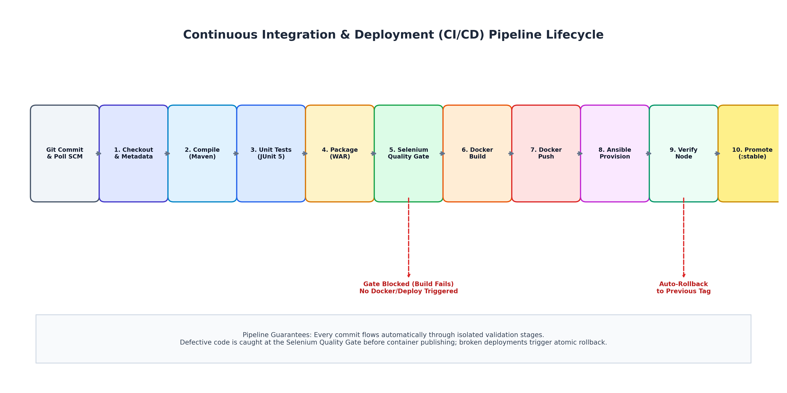
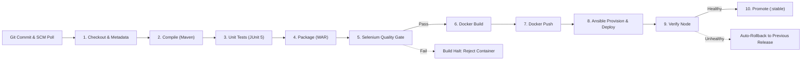
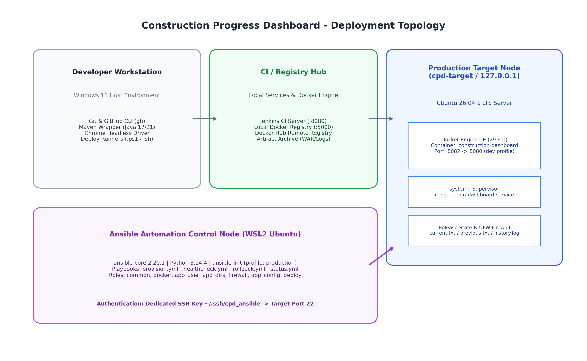
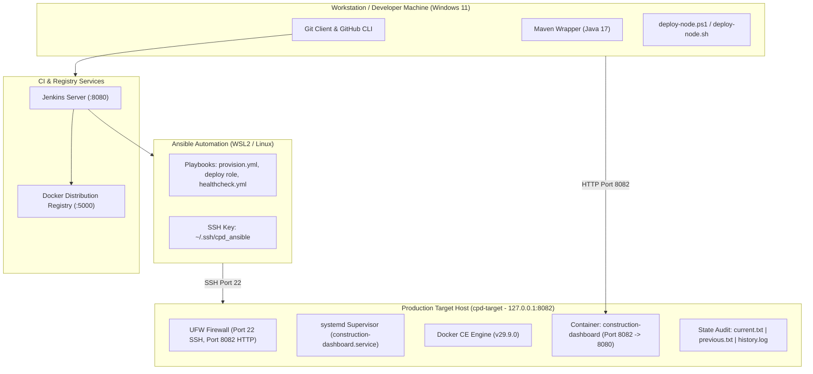
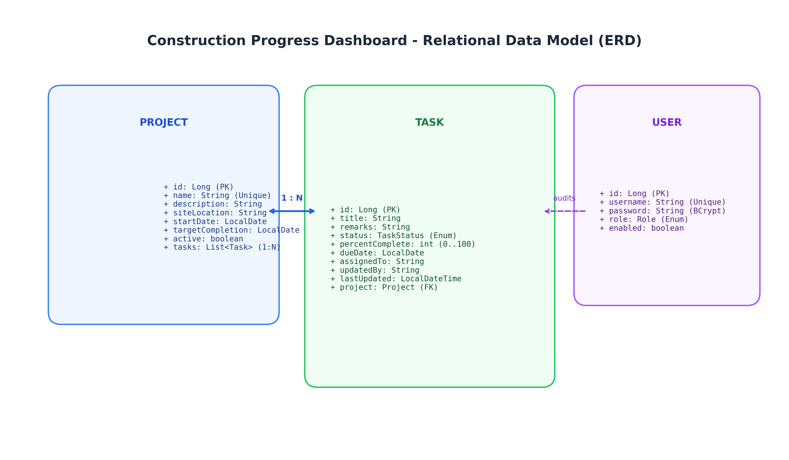
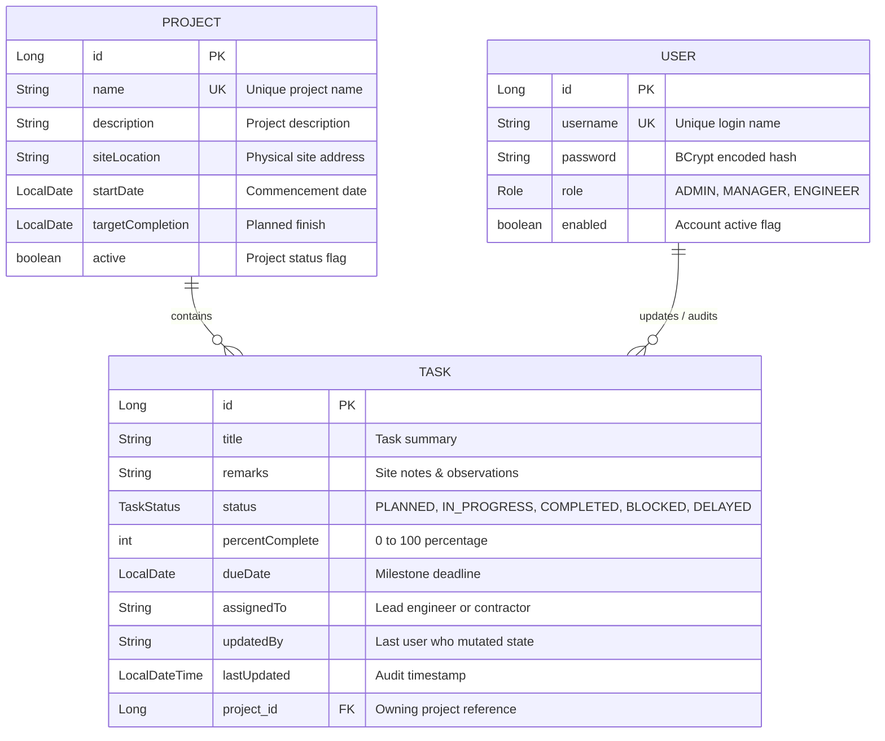

# System Architecture & Technical Specifications 🏗️

This document outlines the architectural blueprints, subsystem designs, continuous delivery lifecycle, deployment topology, data models, and security governance for the **Construction Progress Dashboard**.

---

## 📋 Table of Contents

1. [High-Level Application Architecture](#1-high-level-application-architecture)
2. [CI/CD Pipeline Architecture & Quality Gates](#2-cicd-pipeline-architecture--quality-gates)
3. [Deployment Topology & Production Runtime](#3-deployment-topology--production-runtime)
4. [Relational Data Model & Domain Design](#4-relational-data-model--domain-design)
5. [Security Architecture & Governance](#5-security-architecture--governance)

---

## 1. High-Level Application Architecture

The application is structured following classic enterprise layered architecture principles implemented via Spring Boot 3.3.4 and Java 17. Separation of concerns is strictly maintained across presentation, business logic, persistence, and security tiers.

### Architecture Diagram


### Architectural Layers

```mermaid
graph TD
    subgraph ClientTier["Client Tier"]
        Browser["Modern Web Browsers (Desktop / Tablet)"]
        Selenium["Automated Selenium Headless Chrome Driver"]
    end

    subgraph SecurityTier["Security Tier (Spring Security 6)"]
        FilterChain["SecurityFilterChain & DelegatingFilterProxy"]
        AuthManager["AuthenticationProvider & BCryptPasswordEncoder"]
        RBAC["Role-Based Authorization Rules (ADMIN, MANAGER, ENGINEER)"]
    end

    subgraph PresentationTier["Presentation Tier (Spring MVC & Thymeleaf)"]
        Controllers["Controllers: Dashboard, Task, Status, Alerts, AdminProject, Health"]
        Views["Thymeleaf HTML5 Templates & Bootstrap 5 Fragments"]
    end

    subgraph ServiceTier["Business Logic Tier"]
        TaskSvc["TaskService: KPI Calculations, Delay Triggers, Auto-Completion"]
        ProjSvc["ProjectService: Construction Site Management"]
        UserSvc["CustomUserDetailsService: Credential & Role Resolution"]
    end

    subgraph DataAccessTier["Persistence Tier (Spring Data JPA / Hibernate 6)"]
        TaskRepo["TaskRepository (JPA Specification Filtering)"]
        ProjRepo["ProjectRepository"]
        UserRepo["UserRepository"]
    end

    subgraph StorageTier["Database Engine"]
        H2["In-Memory H2 Database (Dev / Test / Demo Profiles)"]
        RDBMS["PostgreSQL / MySQL Production Target Engine"]
    end

    ClientTier --> SecurityTier
    SecurityTier --> PresentationTier
    PresentationTier --> ServiceTier
    ServiceTier --> DataAccessTier
    DataAccessTier --> StorageTier
```



### Component Responsibilities

1. **Client Tier**:
   - Renders responsive Bootstrap 5 interface for site personnel.
   - Evaluated continuously during CI via Headless Chrome automated user journeys.
2. **Security Tier**:
   - Enforces authentication before state mutations.
   - Restricts administrative capabilities (`/admin/**`) to `ROLE_ADMIN`.
   - Protects forms with Spring Security Synchronizer Token CSRF tokens.
3. **Presentation Tier**:
   - `DashboardController`: Aggregates active milestones, calculates percentage progress, and handles multi-parameter filter queries.
   - `TaskController`: Handles task creation, detail inspection, and status modifications.
   - `StatusController` & `AlertsController`: Specialized views for delayed, blocked, and overdue tasks.
   - `AdminProjectController`: Project lifecycle and site boundary administration.
   - `HealthController`: Standard `/health` actuator-style probe returning JSON payload `{"status":"UP"}`.
4. **Service Tier**:
   - Encapsulates domain validation rules: e.g., setting task status to `COMPLETED` automatically forces `percentComplete = 100`.
   - Computes overdue task state dynamically by evaluating target completion deadlines against system time (`LocalDate.now()`).
5. **Persistence Tier**:
   - Uses Spring Data JPA specifications to perform dynamic, multi-column search queries on the task repository without boilerplate SQL.

---

## 2. CI/CD Pipeline Architecture & Quality Gates

The continuous integration and deployment pipeline is orchestrated through a declarative Jenkinsfile (`Jenkinsfile`) operating on a Jenkins automation server. Every Git commit triggers an automated pipeline run.

### Pipeline Flow Diagram



### Pipeline Stages & Quality Enforcement



### Key Pipeline Guarantees

1. **Deterministic Tagging**: Images are uniquely identified using `<version>-b<build>-<sha>` (e.g., `0.0.1-SNAPSHOT-b3-73fa1bc`), eliminating overwrite conflicts and guaranteeing traceability back to the exact Git commit.
2. **Automated Selenium Quality Gate**: 
   - Runs headless Google Chrome against dynamic Spring Boot test instances.
   - Tests 3 critical user journeys: Authentication/RBAC, Task Creation & Automatic Milestone Calculation, and Status Updates.
   - A single UI regression or form failure immediately aborts the build, preventing image creation and registry publishing.
3. **Container Registry Isolation**: Images are published to the target registry (`localhost:5000` or Docker Hub) with both the build tag and `:latest`.
4. **Resilient Ansible Delivery**:
   - Executes `ansible/playbooks/provision.yml` with the newly built image tag.
   - Uses an Ansible `block` / `rescue` pattern to guarantee that any deployment failure triggers an automatic atomic rollback to the prior functioning release.
5. **Verification & Promotion**:
   - Verifies HTTP `/health` and the live HTML version tag on the deployed node.
   - Only upon 100% verification is the Docker image promoted to `:stable`.

---

## 3. Deployment Topology & Production Runtime

The application deployment topology connects the developer environment, the continuous integration cluster, and the target production node running an isolated Linux host.

### Deployment Topology Diagram



### Node Specifications & Interfaces



### Target Node Directory Structure

The managed application node maintains an immutable, standardized layout under `/opt/construction-dashboard`:

```text
/opt/construction-dashboard/
├── config/
│   └── app.env                     # Environment variables (SPRING_PROFILES_ACTIVE, SERVER_PORT, JAVA_OPTS) [mode: 0600, appdeploy:docker]
├── logs/                           # Mounted application logs [mode: 0750, appdeploy:docker]
└── releases/                       # State and audit files [mode: 0755, appdeploy:docker]
    ├── current.txt                 # Active image tag (e.g., 1.1.0)
    ├── previous.txt                # Prior stable image tag for atomic rollback
    └── history.log                 # Append-only chronological release ledger
```

---

## 4. Relational Data Model & Domain Design

The domain model represents the core entities required for civil engineering project tracking: projects, tasks, and system users.

### Entity Relationship Diagram (ERD)



### Domain Entities



---

## 5. Security Architecture & Governance

The platform adheres to the principle of least privilege and defense-in-depth across the application, container, host, and network tiers.

### Security Layers

1. **Authentication & Password Protection**:
   - Passwords stored exclusively as salted hashes using Spring Security `BCryptPasswordEncoder` (work factor 10).
   - Form-based login handles authentication and invalidates expired sessions.
2. **Authorization & RBAC**:
   - `ADMIN`: Project creation/modification (`/admin/**`), task mutations, dashboard viewing.
   - `MANAGER`: Dashboard access (`/dashboard`), status inspection (`/status/**`), and alert management (`/alerts`).
   - `ENGINEER`: Task creation and editing (`/tasks/**`).
3. **CSRF Protection**:
   - Synchronizer token pattern enabled on all mutating HTTP requests (POST). Thymeleaf automatically injects `_csrf` tokens into all rendered forms.
4. **Least-Privilege Containerization**:
   - Multi-stage Docker image builds binaries in a build stage and copies only the WAR into an Eclipse Temurin 17 JRE minimal runtime image.
   - Executes under a dedicated unprivileged user (`appuser:appgroup`, UID 10001).
5. **Operating System & Network Hardening**:
   - Dedicated Linux system user `appdeploy` with restricted shell access.
   - Configuration file `/opt/construction-dashboard/config/app.env` restricted to `0600` permissions.
   - UFW firewall enforces default-deny inbound traffic, explicitly allowing only Port 22 (SSH) and Port 8082 (Application).
6. **Credential Isolation in CI/CD**:
   - No plaintext passwords, Docker Hub tokens, or SSH private keys are checked into source control.
   - Credentials are injected dynamically in Jenkins via Jenkins Credential Store (`cpd-ansible-ssh`, `dockerhub-credentials`) or local environment variables.
