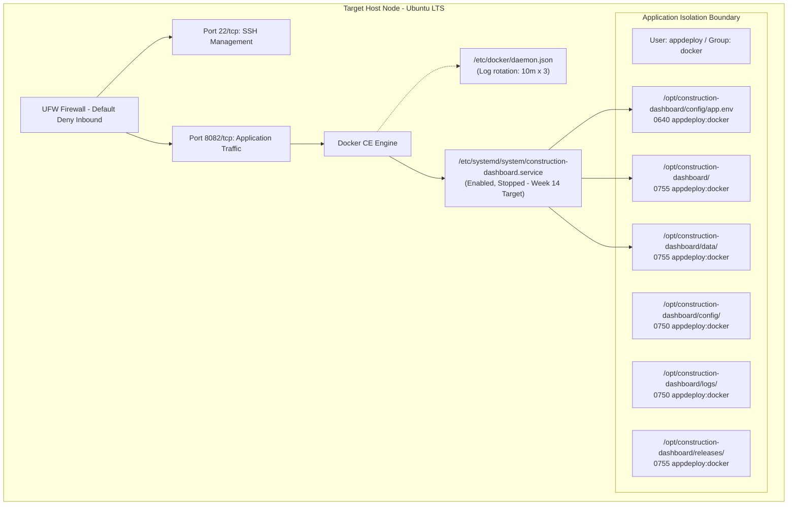

# Construction Progress Dashboard — Server Configuration Specification 📋

**Document**: Server Prerequisites and Desired State Specification  
**Project**: Construction Progress Dashboard (Java 17, Spring Boot 3.3.4, Dockerized Deployment)  
**Milestone**: Week 13 — Ansible Configuration Management  
**Target Environment**: Ubuntu 22.04 / 24.04 / 26.04 LTS (x86_64)  
**Application Host Port**: `8082/tcp` (mapped to internal container port `8080/tcp`)  

---

## 1. Overview & Architectural Intent

This specification formalizes the exact desired state of the target production-grade server node before application deployment (Week 14). The Ansible playbook configures the host operating system, establishes isolation boundaries, installs Docker Engine from the official upstream repository, configures system logging limits, establishes strict firewall rules via UFW, sets up dedicated non-privileged user accounts, and deploys systemd integration units.

---

## 2. Server Prerequisites Specification Tables

### 2.1 OS Packages

| Ansible Module | Package Name(s) | Target State | Why / Architectural Rationale |
|---|---|---|---|
| `ansible.builtin.apt` | `ca-certificates` | `present` | Ensures trusted SSL/TLS communication with apt repositories and Docker Hub registry. |
| `ansible.builtin.apt` | `curl` | `present` | Essential HTTP client for downloading GPG keys, system health probes, and API queries. |
| `ansible.builtin.apt` | `gnupg` | `present` | Required for cryptographically verifying upstream Docker apt repository signing keys. |
| `ansible.builtin.apt` | `ufw` | `present` | Uncomplicated Firewall utility to enforce host-level network perimeter access control. |
| `ansible.builtin.apt` | `python3` | `present` | Python runtime for Ansible execution modules, system automation, and script execution. |
| `ansible.builtin.apt` | `python3-apt` | `present` | Python bindings for APT package manager required by `ansible.builtin.apt` module. |
| `ansible.builtin.apt` | `docker-ce` `docker-ce-cli` `containerd.io` `docker-compose-plugin` | `present` | Official Docker Engine runtime components to build, pull, isolate, and execute containers. |

---

### 2.2 Users & Security Groups

| Ansible Module | Identifier | Type | Attributes & Group Membership | Why / Architectural Rationale |
|---|---|---|---|---|
| `ansible.builtin.group` | `docker` | Group | System group `docker` (`present`) | Standard group created by Docker package to grant non-root container management rights. |
| `ansible.builtin.user` | `appdeploy` | User | System user (`system: true`), shell `/bin/bash`, home `/opt/construction-dashboard`, groups `docker`, no login password (`password_lock: true`) | Principle of least privilege: dedicated non-login service account that owns application runtime directories and executes Docker commands without root access. |

---

### 2.3 Directory Structure & Permissions

| Ansible Module | Directory Path | Owner | Group | Mode | Why / Architectural Rationale |
|---|---|---|---|---|---|
| `ansible.builtin.file` | `/opt/construction-dashboard` | `appdeploy` | `docker` | `0755` | Base deployment root directory; world-readable, writable by application owner. |
| `ansible.builtin.file` | `/opt/construction-dashboard/config` | `appdeploy` | `docker` | `0750` | Restricted configuration directory storing sensitive environment variables and tokens; no access for other users. |
| `ansible.builtin.file` | `/opt/construction-dashboard/logs` | `appdeploy` | `docker` | `0750` | Persistent log storage directory mounted or archived from container execution; restricted access. |
| `ansible.builtin.file` | `/opt/construction-dashboard/releases` | `appdeploy` | `docker` | `0755` | Release version metadata directory for zero-downtime release deployments and rollback records. |
| `ansible.builtin.file` | `/opt/construction-dashboard/data` | `appdeploy` | `docker` | `0755` | Persistent database storage directory mounted into container as `/app/data` to preserve file-based H2 database across redeployments. |

---

### 2.4 Configuration & Service Files

| Ansible Module | File Path | Owner:Group | Mode | Content / Source | Why / Architectural Rationale |
|---|---|---|---|---|---|
| `ansible.builtin.template` | `/etc/docker/daemon.json` | `root:root` | `0644` | JSON log-driver rotation configuration: `json-file`, `max-size: 10m`, `max-file: 3` | Prevents disk space exhaustion from container stdout/stderr logs filling the root partition. |
| `ansible.builtin.template` | `/opt/construction-dashboard/config/app.env` | `appdeploy:docker` | `0640` | Key-value pairs: `APP_VERSION`, `SPRING_PROFILES_ACTIVE`, `SERVER_PORT`, `JAVA_OPTS` | Centralized external configuration file consumed by Docker via `--env-file`. Note: `SPRING_PROFILES_ACTIVE=dev` is for this course demo only. |
| `ansible.builtin.template` | `/etc/systemd/system/construction-dashboard.service` | `root:root` | `0644` | Systemd service definition unit managing container lifecycle (`docker run` with `-v /opt/construction-dashboard/data:/app/data` / `docker stop`) | Integrates application container lifecycle with host system initialization, persistent storage volume mount, auto-restart, and supervision. |

---

### 2.5 Firewall Rules (UFW)

| Ansible Module | Port / Protocol | Direction | Policy / Action | Why / Architectural Rationale |
|---|---|---|---|---|
| `ansible.posix.ufw` | `22/tcp` | Inbound | `allow` | **Allowed first** to ensure remote administrator and Ansible control node are never locked out of SSH access. |
| `ansible.posix.ufw` | `8082/tcp` | Inbound | `allow` | Exposes application host port mapped to internal container port 8080. |
| `ansible.posix.ufw` | `*` | Inbound | `default: deny` | Principle of defense-in-depth: all unapproved incoming traffic is rejected by default. |
| `ansible.posix.ufw` | `*` | Outbound | `default: allow` | Allows outbound connections for OS updates, package downloads, and Docker image pulls. |
| `ansible.posix.ufw` | N/A | Host | `state: enabled` | Enables UFW firewall upon system boot and applies all rules dynamically. |

---

### 2.6 System Services State

| Ansible Module | Service Name | Desired State (Week 13) | Enabled on Boot | Why / Architectural Rationale |
|---|---|---|---|---|
| `ansible.builtin.systemd` | `docker` | `started` | `true` | Container daemon must be active and running to support image operations. |
| `ansible.builtin.systemd` | `ufw` | `started` | `true` | Firewall daemon must be active and enforcing network traffic rules. |
| `ansible.builtin.systemd` | `construction-dashboard` | `stopped` | `true` | **Explicitly kept stopped in Week 13**: The service unit is verified, registered, and enabled, but the application deployment and container launch occur in Week 14. |

---

## 3. Configuration Variables Specification

The Ansible playbook parameterizes all environment-specific values in `ansible/group_vars/app_servers.yml`:

| Variable Name | Default Value | Description |
|---|---|---|
| `app_user` | `appdeploy` | System username created to manage and execute the application container. |
| `app_group` | `docker` | Primary security group assigned to `app_user`. |
| `app_dir` | `/opt/construction-dashboard` | Base installation directory path on the target server. |
| `app_port` | `8082` | Host port on which the container's internal port (8080) is published and exposed through UFW. |
| `container_name` | `construction-dashboard` | Docker container identifier assigned during execution. |
| `docker_image` | `ganesh/construction-dashboard` | Docker repository published in Week 12 on Docker Hub (or local registry). |
| `image_tag` | `stable` | Docker image tag deployed on the target server (promoted stable tag). |
| `spring_profile` | `dev` | Active Spring Boot runtime profile (`dev` profile with H2 in-memory DB for demo purposes). |
| `app_version` | `1.0.0` | Semantic application version recorded in `app.env`. |
| `java_opts` | `-Xms128m -Xmx256m` | JVM memory tuning parameters for containerized deployment. |
| `firewall_allowed_ports` | `['22/tcp', '8082/tcp']` | List of inbound ports allowed through UFW firewall. |
| `timezone` | `Asia/Kolkata` | Host system timezone configuration. |

---

## 4. Idempotency Strategy

To ensure safe, repeatable, and convergent playbook runs without configuration drift or side effects:

1. **Declarative State Enforcement**:
   - Utilize native built-in modules (`ansible.builtin.apt`, `ansible.builtin.file`, `ansible.builtin.user`, `ansible.builtin.template`, `ansible.builtin.systemd`, `ansible.posix.ufw`) that check existing state before modifying.
   - Prohibit un-guarded `shell` and `command` invocations. Where command execution is necessary (e.g., GPG de-armoring), strictly guard with `creates: <filepath>` or explicit `changed_when: false`.

2. **Atomic Template Updates & Handlers**:
   - Configuration templates (`daemon.json`, `construction-dashboard.service`) notify handlers (`restart docker`, `daemon-reload`) only when actual file content changes occur.

3. **Safe Firewall Ordering**:
   - Port `22/tcp` is allowed before setting default inbound policy to `deny` and enabling UFW, preventing lockout.

4. **Zero-Change Second Run**:
   - Executing the complete playbook against an already-configured target node produces `changed=0, failed=0`.
