# 10-Minute Live Demo Runbook & Presentation Script 🎬

This document provides a minute-by-minute live demonstration script for presenting the **Construction Progress Dashboard** project to instructors, assessors, and examiners. It includes exact URLs, commands, expected console outputs, talking points, pre-flight checklists, and fallback plans for each demonstration segment.

---

## 📋 Pre-Flight Checklist (T-minus 15 Minutes)

Ensure all local and virtualized services are running and primed before initiating the demonstration:

| # | Check Item | Verification Command / URL | Expected State | Fallback if Down |
|---|---|---|---|---|
| **1** | Docker Desktop Engine | `docker version` | Docker daemon running, client & server OK | Start Docker Desktop via Windows Start Menu |
| **2** | Jenkins Automation Server | `http://localhost:8080` | Jenkins UI login page or dashboard accessible | Run `net start jenkins` or launch local Jenkins agent |
| **3** | Docker Registry | `curl http://localhost:5000/v2/_catalog` | Returns `{"repositories":["construction-dashboard"]}` | `docker run -d -p 5000:5000 --name registry registry:2` |
| **4** | Ubuntu Target Node (`cpd-target`) | `wsl.exe -d Ubuntu -u ganesh -- ansible app_servers -i ansible/inventory/hosts.yml -m ping` | Returns `cpd-target-node \| SUCCESS => {"ping": "pong"}` | Ensure WSL2 instance is started: `wsl -d Ubuntu -u ganesh` |
| **5** | Application Container on Target | `curl -s http://127.0.0.1:8082/health` | Returns `{"status":"UP"}` | `scripts/deploy-node.ps1` or run `provision.yml` |
| **6** | Browser Tabs Prepared | Open in Google Chrome | Tab 1: `http://127.0.0.1:8082/login`<br>Tab 2: `http://localhost:8080/job/construction-dashboard-pipeline`<br>Tab 3: GitHub Repo Releases (`https://github.com/ganesh-dahiphale/construction_project_dashboard/releases`) | Keep offline evidence reports ready in `docs/evidence/` |

---

## ⏱️ 10-Minute Demonstration Timeline

```mermaid
gantt
    title 10-Minute DevOps Live Demonstration Schedule
    dateFormat  mm
    axisFormat  %M:%S
    Introduction & Problem Statement        :00, 1m
    Live Application Feature Walkthrough    :01, 2m
    Automated CI/CD Pipeline (Jenkinsfile)  :03, 2m
    Ansible Deployment & Idempotency        :05, 2m
    Failure Injection & Automated Rollback  :07, 1m
    Evidence, Releases & Viva Wrap-up       :08, 2m
```



---

## 🎙️ Step-by-Step Demonstration Script

### Minute 00:00 – 01:00: Problem Statement & High-Level Architecture
- **Speaker Script**:  
  > "Good morning/afternoon. Today I am presenting the final release of the Construction Progress Dashboard. On infrastructure projects, miscommunication between field engineers and project managers causes costly delays. We built an enterprise Spring Boot application packaged in Docker, secured by automated Selenium quality gates in Jenkins, and continuously deployed using Ansible with automated health verification and rollback."
- **Visual**: Show `docs/images/application_architecture.png` or `docs/images/deployment_topology.png`.

---

### Minute 01:00 – 03:00: Live Application & Role-Based Access Walkthrough
- **Action 1**: Navigate to `http://127.0.0.1:8082/login` in the browser.
  - Note the version badge: `Version: 1.1.0 - Final Release Demo`.
- **Action 2**: Log in as Site Engineer (`engineer` / `engineer123`).
  - Navigate to `/tasks/new`. Create a task:
    - Title: `Concrete Pouring Pier P4`
    - Status: `IN_PROGRESS`
    - Completion: `65%`
    - Assigned To: `Ganesh (Field Lead)`
  - Click **Save Task**.
- **Action 3**: Log out and log in as Project Manager (`manager` / `manager123`).
  - Show the **Executive Dashboard** (`/dashboard`):
    - Highlight KPI Cards: Completed, In Progress, Blocked, Delayed.
    - Demonstrate dynamic search filter by keyword `Pier`.
  - Navigate to `/alerts`: show automated detection of delayed/overdue tasks.
- **Action 4**: Log in as Admin (`admin` / `admin123`).
  - Navigate to `/admin/projects`: show site boundary administration.
- **Fallback**: If browser is slow, show pre-recorded video or screenshots from `docs/evidence/week15/login_page_footer.png`.

---

### Minute 03:00 – 05:00: Automated CI/CD Pipeline in Jenkins
- **Speaker Script**:  
  > "Quality is enforced through code. Every commit triggers our declarative Jenkinsfile. Let us inspect Build #3, which delivered our v1.1.0 release."
- **Action**: Open Jenkins Pipeline View (`http://localhost:8080/job/construction-dashboard-pipeline`).
- **Walkthrough Stages**:
  1. **Build & Unit Tests**: 58 unit and integration tests executed with 0 failures (18.8s).
  2. **Package**: Generates production WAR (`target/dashboard.war`).
  3. **Selenium Quality Gate (Stage 5)**: Automated Headless Chrome runs 3 user journeys. Explain: *“If any UI or DOM regression occurs, the pipeline terminates immediately. Defective images are never built or pushed.”*
  4. **Docker Build & Push**: Creates immutable image `localhost:5000/construction-dashboard:0.0.1-SNAPSHOT-b3-73fa1bc` and pushes to registry.
  5. **Ansible Provision & Deploy (Stage 8)**: Executes Ansible provisioning and zero-downtime deployment.
  6. **Verify Node & Promote**: Checks HTTP `/health` probe and UI version before promoting to `:stable`.
- **Fallback**: Open `docs/evidence/week15/consoleText.txt` and review the logged pipeline timeline table.

---

### Minute 05:00 – 07:00: Ansible Deployment, Idempotency & Live Node State
- **Speaker Script**:  
  > "Ansible provisions the target node and enforces strict idempotency. Let us verify the live state on our target Ubuntu server."
- **Action 1 (Terminal)**: Inspect live runtime on target:
  ```powershell
  wsl.exe -d Ubuntu -u ganesh -- ssh -i ~/.ssh/cpd_ansible ganesh@127.0.0.1 "sudo docker ps; sudo cat /opt/construction-dashboard/releases/current.txt; sudo tail -n 3 /opt/construction-dashboard/releases/history.log"
  ```
- **Expected Console Output**:
  ```text
  CONTAINER ID   IMAGE                                         STATUS                 PORTS
  f6b0eb8ba7d8   localhost:5000/construction-dashboard:1.1.0   Up 2 hours (healthy)   0.0.0.0:8082->8080/tcp
  1.1.0
  2026-10-14 22:41:45 UTC DEPLOYED 1.1.0
  ```
- **Action 2 (Demonstrate Idempotency)**:
  ```powershell
  wsl.exe -d Ubuntu -u ganesh -- bash -c "ANSIBLE_ROLES_PATH=ansible/roles ansible-playbook -i ansible/inventory/hosts.yml ansible/playbooks/provision.yml -e release_tag=1.1.0"
  ```
- **Expected Console Output**:
  ```text
  PLAY RECAP ********************************************************************
  cpd-target-node : ok=37 changed=0 unreachable=0 failed=0 skipped=3
  ```
  - *Talking Point*: `changed=0` proves complete idempotency. No services were unnecessarily restarted.

---

### Minute 07:00 – 08:30: Production Protection & Automated Rollback
- **Speaker Script**:  
  > "What happens if a bad release reaches production? Our Ansible deployment role uses a block/rescue pattern with synthetic health polling. If a new container fails health checks, it atomically rolls back to the previous stable release."
- **Action**: Review Week 14 rollback log in `docs/evidence/week14/first-deploy.log`:
  - Show deployment of `broken-demo`.
  - Highlight health probe failure after 25 retries.
  - Show rescue task executing: container rolled back to previous tag (`0.0.1-SNAPSHOT-b1-fe3efe3`).
  - Show verification: `/health` returns `UP` immediately after rollback.
  - Show `history.log`: `ROLLED BACK from broken-demo to 0.0.1-SNAPSHOT-b1-fe3efe3`.

---

### Minute 08:30 – 10:00: Deliverables, Documentation & Conclusion
- **Speaker Script**:  
  > "In conclusion, we have delivered a complete DevOps lifecycle: Git branching, Jenkins declarative pipeline, automated Selenium testing, Docker containerization, and Ansible configuration management with automated rollback."
- **Action**: Show GitHub Releases page:
  - [`v1.0.0`](https://github.com/ganesh-dahiphale/construction_project_dashboard/releases/tag/v1.0.0): MVP baseline release with packaged WAR.
  - [`v1.1.0`](https://github.com/ganesh-dahiphale/construction_project_dashboard/releases/tag/v1.1.0): Final production release with Jenkins CI/CD, Docker, and Ansible automation.
- **Show Repository Documentation**:
  - `README.md`
  - `docs/ARCHITECTURE.md`
  - `docs/TROUBLESHOOTING.md`
  - `docs/VIVA_PREP.md`
- **Conclude and open for questions**: *"Thank you. I am ready for the viva questions."*

---

## 🆘 Emergency Fallback Matrix

| Failure Mode During Demo | Cause | Immediate Recovery Action |
|---|---|---|
| Port 8082 unreachable | Container stopped or port collision | Run `scripts/deploy-node.ps1` or run `docker restart construction-dashboard` |
| Jenkins UI not responding | Windows service paused | Open PowerShell: `Restart-Service jenkins` or show `docs/evidence/week15/consoleText.txt` |
| WSL Ubuntu target connection fails | SSH daemon inactive in WSL | Run `wsl -d Ubuntu -u root service ssh restart` |
| Git or GitHub API rate limit | Unauthenticated network calls | Use local Git log: `git log --graph --oneline -n 15` |
