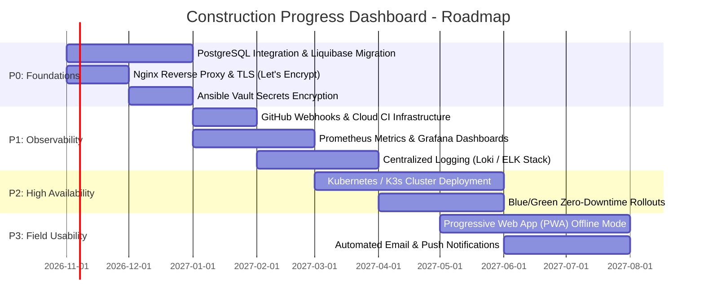

# System Limitations & Future Enhancement Roadmap 🎯

This document provides a transparent, engineering-focused appraisal of the current limitations within the **Construction Progress Dashboard** architecture, deployment pipeline, and security configuration, followed by a prioritized roadmap of future architectural enhancements.

---

## 📋 Table of Contents

1. [Current System Limitations](#1-current-system-limitations)
   - [Data Persistence & In-Memory Database](#data-persistence--in-memory-database)
   - [Topology & Single Node Architecture](#topology--single-node-architecture)
   - [CI/CD Automation & Triggering](#cicd-automation--triggering)
   - [Transport Layer Security (HTTPS / SSL)](#transport-layer-security-https--ssl)
   - [Telemetry, Observability & Alerting](#telemetry-observability--alerting)
   - [Identity, Access Governance & Secrets Management](#identity-access-governance--secrets-management)
2. [Prioritized Future Enhancement Roadmap](#2-prioritized-future-enhancement-roadmap)
   - [Phase 1: Security & Production Database (P0)](#phase-1-security--production-database-p0)
   - [Phase 2: Production Observability & Webhooks (P1)](#phase-2-production-observability--webhooks-p1)
   - [Phase 3: High Availability, Zero Downtime & Orchestration (P2)](#phase-3-high-availability-zero-downtime--orchestration-p2)
   - [Phase 4: Client Capabilities & Mobile Notification (P3)](#phase-4-client-capabilities--mobile-notification-p3)

---

## 1. Current System Limitations

### Data Persistence & In-Memory Database
- **Current State**: The application runs under the `dev` profile using an in-memory **H2 relational database engine**. 
- **Limitation**: Any complete restart or recreation of the container wipes runtime data, recreating default demo entities via `data.sql` and `schema.sql`. In a real-world enterprise setting, construction projects, audit records, and daily task logs must persist across container restarts, migrations, and disaster recovery scenarios.

### Topology & Single Node Architecture
- **Current State**: The production deployment targets a single Ubuntu node (`cpd-target` on `127.0.0.1:8082`).
- **Limitation**: A single node creates a single point of failure (SPOF). While systemd restarts the container within ~17 seconds if it crashes, node-level failures, hardware maintenance, or OS kernel upgrades cause service downtime. No load balancer or horizontal pod auto-scaler is currently in place.

### CI/CD Automation & Triggering
- **Current State**: The Jenkins pipeline triggers via **SCM polling** (`H/2 * * * *` or periodic schedule).
- **Limitation**: Polling incurs a 1-to-2 minute latency between code push and build initiation, while placing continuous unnecessary query load on the GitHub API. In an enterprise environment, event-driven webhooks provide immediate, sub-second build triggers.

### Transport Layer Security (HTTPS / SSL)
- **Current State**: The application serves traffic over unencrypted HTTP on port `8082`.
- **Limitation**: Session cookies (`JSESSIONID`), form data, and user authentication credentials travel across the network in plaintext. Enterprise deployments require TLS 1.3 encryption with automatic certificate management.

### Telemetry, Observability & Alerting
- **Current State**: Health monitoring relies on a static actuator `/health` HTTP endpoint, systemd status queries, and Docker logs.
- **Limitation**: There is no historical metric aggregation (CPU, JVM heap, garbage collection pauses, HTTP request latency, error rates) or automated paging/alerting system (Slack, PagerDuty) to proactively detect degradation before it impacts site engineers.

### Identity, Access Governance & Secrets Management
- **Current State**: Seeded default users (`admin`, `manager`, `engineer`) with default passwords defined in code or environment variables. Credentials in Ansible are passed via plaintext environment flags or workstation SSH keys.
- **Limitation**: No multi-factor authentication (MFA), no integration with enterprise identity providers (SAML, OAuth2/OIDC, Azure AD / Okta), and secrets are not yet encrypted at rest via Ansible Vault or HashiCorp Vault.

---

## 2. Prioritized Future Enhancement Roadmap

### Phase 1: Security & Production Database (Priority P0)

1. **Persistent Relational Database (PostgreSQL / MySQL)**:
   - Introduce production Spring profile (`SPRING_PROFILES_ACTIVE=prod`).
   - Configure containerized PostgreSQL with persistent volume mounts (`/var/lib/postgresql/data`).
   - Implement **Liquibase** or **Flyway** for automated, versioned database schema migrations and rollback scripts.
2. **TLS / HTTPS via Nginx Reverse Proxy**:
   - Provision Nginx as a reverse proxy listening on ports `80` and `443`.
   - Implement automated SSL/TLS certificates via **Let's Encrypt** with `certbot` renewal automation.
   - Enforce HTTP Strict Transport Security (HSTS) and secure cookie flags (`Secure`, `HttpOnly`, `SameSite=Strict`).
3. **Secrets Management with Ansible Vault & HashiCorp Vault**:
   - Encrypt database credentials, API tokens, and private keys using `ansible-vault`.
   - Migrate production credentials into HashiCorp Vault with dynamic ephemeral credential generation.

### Phase 2: Production Observability & Webhooks (Priority P1)

1. **Event-Driven GitHub Webhooks**:
   - Expose Jenkins through a secured public ingress or reverse tunnel to receive instantaneous GitHub webhook payloads on push and pull request events.
2. **Prometheus & Grafana Observability**:
   - Integrate `micrometer-registry-prometheus` into Spring Boot Actuator.
   - Export JVM heap, GC activity, HTTP request rates, response latency percentiles (p95/p99), and database connection pool utilization.
   - Build executive Grafana dashboards and configure alert rules triggering notification on high error rates.
3. **Centralized Log Aggregation**:
   - Deploy Promtail / Fluentd to forward container and systemd logs to **Grafana Loki** or an **Elasticsearch/Kibana** cluster for centralized audit and troubleshooting.

### Phase 3: High Availability, Zero Downtime & Orchestration (Priority P2)

1. **Kubernetes (K3s / EKS) Orchestration**:
   - Codify infrastructure using Helm charts and Kubernetes manifests: `Deployment`, `Service`, `Ingress`, and `HorizontalPodAutoscaler` (HPA).
   - Guarantee automatic pod self-healing, rolling updates, and zero-downtime upgrades.
2. **Blue/Green & Canary Deployments**:
   - Implement blue/green deployment switching at the router/ingress tier to allow zero-downtime releases with instant rollback capability without restarting containers on the live path.
3. **Enterprise Identity Federation (SSO)**:
   - Integrate Spring Security with **OAuth2 / OpenID Connect (OIDC)** to support Single Sign-On (SSO) with Azure AD, Google Workspace, or Keycloak, including Multi-Factor Authentication (MFA).

### Phase 4: Client Capabilities & Mobile Notification (Priority P3)

1. **Progressive Web App (PWA) Offline Support**:
   - Add service workers and local caching so site engineers can log progress and photos on remote construction sites with intermittent cellular coverage; background synchronization dispatches updates when connectivity returns.
2. **Automated Notification Engine**:
   - Integrate email (SendGrid/SMTP) and SMS/WhatsApp notifications (Twilio) to alert project managers immediately when a critical path milestone is marked `BLOCKED` or becomes overdue.
