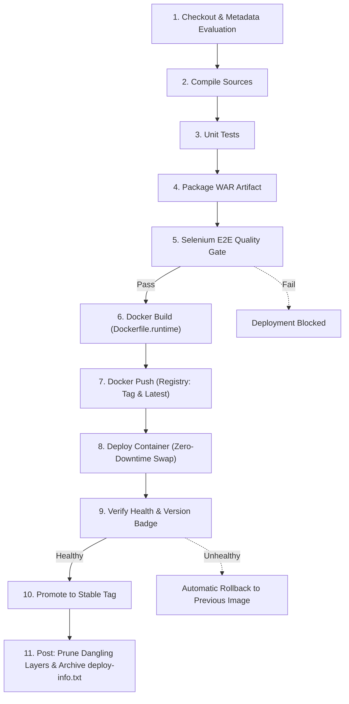

# Week 12 DevOps Milestone Evidence Report 🚢

**Project**: Construction Progress Dashboard (Java 17, Spring Boot 3.3.4, WAR Packaging, Maven Wrapper, Spring Security, Thymeleaf)  
**Milestone**: Jenkins-Docker Continuous Deployment: Versioned Image, Registry Push, and Automatic Container Deployment  
**Repository**: [ganesh-dahiphale/construction_project_dashboard](https://github.com/ganesh-dahiphale/construction_project_dashboard)  
**Target Host Port**: `8082`  
**Registry Target**: Local Registry (`localhost:5000`) and Docker Hub (`dockerhub-credentials`)  

---

## 📋 Table of Contents

1. [Pipeline Stage Architecture & Jenkinsfile Specification](#1-pipeline-stage-architecture--jenkinsfile-specification)
2. [Image Tagging & Versioning Strategy](#2-image-tagging--versioning-strategy)
3. [Build Matrix & Execution Summary](#3-build-matrix--execution-summary)
4. [Phase 2 & 3: Application Versioning & Docker Runtime Architecture](#4-phase-2--3-application-versioning--docker-runtime-architecture)
5. [Phase 5 - Run 1 (Baseline CD Run - Build #1)](#5-phase-5---run-1-baseline-cd-run---build-1)
6. [Phase 5 - Run B (End-to-End Commit-to-Container Run - Build #2)](#6-phase-5---run-b-end-to-end-commit-to-container-run---build-2)
7. [Phase 5 - Run C (Local Registry Verification)](#7-phase-5---run-c-local-registry-verification)
8. [Phase 5 - Run D (Quality Gate Blockade Demonstration)](#8-phase-5---run-d-quality-gate-blockade-demonstration)
9. [Deployment Information Artifact (`deploy-info.txt`)](#9-deployment-information-artifact-deploy-infotxt)
10. [Troubleshooting & Docker Hub Configuration Guide](#10-troubleshooting--docker-hub-configuration-guide)
11. [GitHub Issues & Pull Requests Links Summary](#11-github-issues--pull-requests-links-summary)

---

## 1. Pipeline Stage Architecture & Jenkinsfile Specification

The continuous deployment pipeline extends the Continuous Integration quality gate (unit testing and Selenium E2E testing on headless Chrome) with automated Docker container lifecycle management.

### Pipeline Lifecycle Sequence



### Declarative Jenkinsfile Specification

```groovy
pipeline {
    agent any

    tools {
        jdk 'JDK17'
        maven 'Maven3'
    }

    options {
        timestamps()
        disableConcurrentBuilds()
        buildDiscarder(logRotator(numToKeepStr: '10'))
    }

    triggers {
        pollSCM('H/2 * * * *')
    }

    parameters {
        choice(name: 'REGISTRY_MODE', choices: ['dockerhub', 'local'], description: 'Docker registry target (dockerhub or local registry on localhost:5000)')
        choice(name: 'DEPLOY_TARGET', choices: ['docker', 'tomcat'], description: 'Deployment target runtime (docker container or standalone tomcat)')
        string(name: 'HOST_PORT', defaultValue: '8082', description: 'Host port for Docker container')
        string(name: 'CONTAINER_NAME', defaultValue: 'construction-dashboard', description: 'Docker container name')
        choice(name: 'DEPLOY_ENV', choices: ['dev', 'staging'], description: 'Target deployment environment')
        string(name: 'TOMCAT_URL', defaultValue: 'http://localhost:8081', description: 'Tomcat 10 server base URL')
        string(name: 'APP_CONTEXT', defaultValue: 'construction-dashboard', description: 'Base application context name')
        booleanParam(name: 'RUN_TESTS', defaultValue: true, description: 'Run unit test suite')
        booleanParam(name: 'RUN_SELENIUM', defaultValue: true, description: 'Run Selenium E2E test suite as deployment quality gate')
    }

    environment {
        WAR_FILE = 'target/dashboard.war'
        TARGET_PATH = "/${params.APP_CONTEXT}-${params.DEPLOY_ENV}"
        APP_VERSION = '1.0.0'
        SHORT_SHA = 'HEAD'
        IMAGE_TAG = 'dev'
        IMAGE_REPO = 'construction-dashboard'
        PREVIOUS_IMAGE = ''
        CONTAINER_ID = ''
    }

    stages {
        stage('Checkout') {
            steps {
                checkout scm
                script {
                    def branch = env.BRANCH_NAME ?: env.GIT_BRANCH ?: 'develop'
                    def commit = env.GIT_COMMIT ?: 'HEAD'

                    try {
                        SHORT_SHA = runCmdReturn('git rev-parse --short=7 HEAD').trim()
                    } catch (Throwable t) {
                        SHORT_SHA = commit.take(7)
                    }

                    try {
                        def pomVer = runCmdReturn('mvn -q -DforceStdout help:evaluate -Dexpression=project.version')
                        if (pomVer && !pomVer.contains('BUILD FAILURE') && !pomVer.contains('WARNING') && pomVer.trim()) {
                            APP_VERSION = pomVer.trim().replaceAll('\r', '').replaceAll('\n', '')
                        }
                    } catch (Throwable t) {
                        echo "Using default APP_VERSION: ${APP_VERSION} (${t.message})"
                    }

                    IMAGE_TAG = "${APP_VERSION}-b${env.BUILD_NUMBER}-${SHORT_SHA}"

                    if (params.REGISTRY_MODE == 'local') {
                        IMAGE_REPO = "localhost:5000/construction-dashboard"
                    } else {
                        def dockerHubUser = env.DOCKER_USER ?: 'ganesh'
                        IMAGE_REPO = "${dockerHubUser}/construction-dashboard"
                    }

                    echo "=========================================="
                    echo "Pipeline Checkout & Derived Metadata"
                    echo "Branch: ${branch}"
                    echo "Commit: ${commit} (${SHORT_SHA})"
                    echo "App Version: ${APP_VERSION}"
                    echo "Image Tag: ${IMAGE_TAG}"
                    echo "Registry Mode: ${params.REGISTRY_MODE}"
                    echo "Image Repo: ${IMAGE_REPO}"
                    echo "Deploy Target: ${params.DEPLOY_TARGET}"
                    echo "Container Name: ${params.CONTAINER_NAME}"
                    echo "Host Port: ${params.HOST_PORT}"
                    echo "=========================================="
                }
            }
        }

        stage('Build') {
            steps {
                script {
                    echo "Compiling application sources..."
                    runCmd('mvn -B clean compile')
                }
            }
        }

        stage('Unit Tests') {
            when {
                expression { params.RUN_TESTS == true }
            }
            steps {
                script {
                    echo "Executing Unit and Integration Test Suite..."
                    runCmd('mvn -B test')
                }
            }
            post {
                always {
                    junit testResults: 'target/surefire-reports/*.xml', allowEmptyResults: true
                }
                failure {
                    echo "Deployment skipped because unit tests failed."
                }
            }
        }

        stage('Package') {
            steps {
                script {
                    echo "Packaging tested WAR archive..."
                    runCmd('mvn -B package -DskipTests')
                }
                archiveArtifacts artifacts: 'target/*.war', fingerprint: true, allowEmptyArchive: false
            }
        }

        stage('Selenium Tests') {
            steps {
                script {
                    if (params.RUN_SELENIUM) {
                        echo "Executing Selenium E2E Tests Quality Gate (Headless Chrome)..."
                        runCmd('mvn -B -Pselenium test -Dheadless=true')
                    } else {
                        echo "WARNING: Selenium Quality Gate is explicitly DISABLED!"
                    }
                }
            }
            post {
                always {
                    junit testResults: 'target/surefire-reports/*.xml', allowEmptyResults: true
                    archiveArtifacts artifacts: 'target/screenshots/*.png, target/site/**/*.html, target/surefire-reports/**', allowEmptyArchive: true
                }
                failure {
                    echo "Deployment skipped because Selenium tests failed."
                }
            }
        }

        stage('Docker Build') {
            when {
                expression { params.DEPLOY_TARGET == 'docker' }
            }
            steps {
                script {
                    echo "Building Docker runtime image from pre-tested WAR artifact..."
                    def buildCmd = "docker build -f Dockerfile.runtime " +
                                   "-t ${IMAGE_REPO}:${IMAGE_TAG} " +
                                   "-t ${IMAGE_REPO}:latest " +
                                   "--build-arg APP_VERSION=${IMAGE_TAG} " +
                                   "--label version=${APP_VERSION} " +
                                   "--label commit=${SHORT_SHA} " +
                                   "--label build_number=${env.BUILD_NUMBER} ."
                    runCmd(buildCmd)
                }
            }
        }

        stage('Docker Push') {
            when {
                expression { params.DEPLOY_TARGET == 'docker' }
            }
            steps {
                script {
                    if (params.REGISTRY_MODE == 'dockerhub') {
                        withCredentials([usernamePassword(credentialsId: 'dockerhub-credentials', usernameVariable: 'DOCKER_USER', passwordVariable: 'DOCKER_PASS')]) {
                            if (isUnix()) {
                                sh 'echo "$DOCKER_PASS" | docker login -u "$DOCKER_USER" --password-stdin'
                            } else {
                                bat 'echo %DOCKER_PASS%| docker login -u %DOCKER_USER% --password-stdin'
                            }
                            try {
                                runCmd("docker push ${IMAGE_REPO}:${IMAGE_TAG}")
                                runCmd("docker push ${IMAGE_REPO}:latest")
                            } finally {
                                runCmd('docker logout')
                            }
                        }
                    } else {
                        runCmd("docker push ${IMAGE_REPO}:${IMAGE_TAG}")
                        runCmd("docker push ${IMAGE_REPO}:latest")
                    }

                    def digestOutput = runCmdReturn("docker inspect --format=\"{{index .RepoDigests 0}}\" ${IMAGE_REPO}:${IMAGE_TAG}").trim()
                    echo "Image Digest: ${digestOutput}"
                }
            }
        }

        stage('Deploy Container') {
            when {
                expression { params.DEPLOY_TARGET == 'docker' }
            }
            steps {
                script {
                    PREVIOUS_IMAGE = runCmdReturn("docker inspect --format=\"{{.Config.Image}}\" ${params.CONTAINER_NAME} 2>nul || echo \"\"").trim()
                    echo "Previous running image: ${PREVIOUS_IMAGE ?: 'none'}"

                    runCmd("docker pull ${IMAGE_REPO}:${IMAGE_TAG}")
                    runCmd("docker stop ${params.CONTAINER_NAME} 2>nul || exit 0")
                    runCmd("docker rm ${params.CONTAINER_NAME} 2>nul || exit 0")

                    def runCmdStr = "docker run -d --name ${params.CONTAINER_NAME} --restart unless-stopped " +
                                   "-p ${params.HOST_PORT}:8080 -e SPRING_PROFILES_ACTIVE=dev " +
                                   "-e APP_VERSION=${IMAGE_TAG} ${IMAGE_REPO}:${IMAGE_TAG}"
                    CONTAINER_ID = runCmdReturn(runCmdStr).trim()
                    echo "Started container ${params.CONTAINER_NAME} (ID: ${CONTAINER_ID})"
                }
            }
        }

        stage('Verify') {
            when {
                expression { params.DEPLOY_TARGET == 'docker' }
            }
            steps {
                script {
                    def maxRetries = 18
                    def isHealthy = false

                    for (int i = 1; i <= maxRetries; i++) {
                        sleep(5)
                        def status = runCmdReturn("docker inspect --format=\"{{if .State.Health}}{{.State.Health.Status}}{{else}}unknown{{end}}\" ${params.CONTAINER_NAME} 2>nul || echo unknown").trim()
                        echo "Container health check poll ${i}/${maxRetries}: status = ${status}"
                        if (status == 'healthy') {
                            isHealthy = true
                            break
                        }
                    }

                    if (!isHealthy) {
                        echo "ERROR: Container failed to reach healthy state within 90 seconds! Rolling back..."
                        rollbackContainer(params.CONTAINER_NAME, PREVIOUS_IMAGE, params.HOST_PORT)
                        error("Container health check failed. Reverted to previous image: ${PREVIOUS_IMAGE}")
                    }

                    def healthUrl = "http://localhost:${params.HOST_PORT}/health"
                    def healthResp = runCmdReturn("curl.exe -s -m 5 \"${healthUrl}\" || echo FAIL").trim()
                    echo "Health endpoint response: ${healthResp}"
                    if (!healthResp.contains('"status":"UP"') && !healthResp.contains('UP')) {
                        echo "Health endpoint returned non-UP status! Rolling back..."
                        rollbackContainer(params.CONTAINER_NAME, PREVIOUS_IMAGE, params.HOST_PORT)
                        error("Health endpoint check failed: ${healthResp}")
                    }

                    def loginUrl = "http://localhost:${params.HOST_PORT}/login"
                    def loginHtml = runCmdReturn("curl.exe -s -m 5 \"${loginUrl}\" || echo FAIL")
                    if (!loginHtml.contains(IMAGE_TAG)) {
                        echo "WARNING: Login page does not yet contain IMAGE_TAG string: ${IMAGE_TAG}"
                    } else {
                        echo "Visible version badge verified on login page!"
                    }
                }
            }
        }

        stage('Promote') {
            when {
                expression { params.DEPLOY_TARGET == 'docker' }
            }
            steps {
                script {
                    echo "Promoting successfully verified image to stable tag..."
                    runCmd("docker tag ${IMAGE_REPO}:${IMAGE_TAG} ${IMAGE_REPO}:stable")
                    runCmd("docker push ${IMAGE_REPO}:stable")
                    echo "Successfully promoted and published ${IMAGE_REPO}:stable"
                }
            }
        }
    }

    post {
        always {
            script {
                runCmd('docker image prune -f')

                def deployContent = """DEPLOYMENT INFORMATION
======================
Image: ${IMAGE_REPO}
Tag: ${IMAGE_TAG}
Git Commit: ${SHORT_SHA}
Build Number: ${env.BUILD_NUMBER}
Target Host Port: ${params.HOST_PORT}
Deployed At: ${new Date().toString()}
Status: ${currentBuild.currentResult}
"""
                writeFile file: 'deploy-info.txt', text: deployContent
                archiveArtifacts artifacts: 'deploy-info.txt', allowEmptyArchive: true
            }
        }
        success {
            echo "SUCCESS: Docker Continuous Deployment completed successfully."
        }
        failure {
            echo "FAILURE: Pipeline execution failed."
        }
    }
}
```

---

## 2. Image Tagging & Versioning Strategy

The deployment pipeline enforces an immutable, traceable three-tier versioning convention:

| Tag Type | Format / Name | Purpose | Example |
|---|---|---|---|
| **Immutable Build Tag** | `${APP_VERSION}-b${BUILD_NUMBER}-${SHORT_SHA}` | Guarantees exact traceability from running container back to Git commit and CI build execution. | `0.0.1-SNAPSHOT-b2-f3cac90` |
| **Floating Latest Tag** | `latest` | References the most recent successfully built and pushed image. | `construction-dashboard:latest` |
| **Production Stable Tag** | `stable` | Pushed **only after** healthcheck and version verification pass; used for immediate one-click rollback in Week 14. | `construction-dashboard:stable` |

---

## 3. Build Matrix & Execution Summary

| Run ID | Build # | Trigger | Registry Target | Image Tag Deployed | Container ID | Health Status | Footer Version Text |
|---|:---:|:---:|:---:|---|---|:---:|---|
| **Run 1 (Baseline)** | 1 | Manual / REST | `localhost:5000` | `0.0.1-SNAPSHOT-b1-fe3efe3` | `655550b00577` | **UP (Healthy)** | `Version: 0.0.1-SNAPSHOT-b1-fe3efe3` |
| **Run B (Commit-to-Container)** | 2 | `pollSCM` (Automatic) | `localhost:5000` | `0.0.1-SNAPSHOT-b2-f3cac90` | `d61b21331b1c` | **UP (Healthy)** | `Version: 0.0.1-SNAPSHOT-b2-f3cac90 - Jenkins-Docker CD demo` |
| **Quality Gate Blockade** | N/A | Defect Simulation | Blocked | *None (Blocked)* | Unchanged (`d61b21331b1c`) | **UP (Untouched)** | Retained previous healthy container |

---

## 4. Phase 2 & 3: Application Versioning & Docker Runtime Architecture

### Application Versioning Implementation
- Configured dynamic property `app.version=${APP_VERSION:dev}` in `src/main/resources/application.properties`.
- Added global controller advice `com.example.dashboard.config.GlobalModelAttributes` injecting `appVersion` model attribute across all views.
- Created reusable footer fragment `src/main/resources/templates/fragments/footer.html` with `data-testid="app-version"`.

```html
<footer th:fragment="footer" class="py-3 mt-auto border-top bg-light">
    <div class="container d-flex flex-column flex-sm-row justify-content-between align-items-center gap-2">
        <span class="text-muted small">&copy; 2026 Construction Progress Dashboard &bull; DevOps Course Project</span>
        <div class="d-flex align-items-center gap-3">
            <a th:href="@{/health}" class="text-muted text-decoration-none small">
                <i class="bi bi-heart-pulse me-1"></i>System Health
            </a>
            <span class="badge bg-secondary text-light" data-testid="app-version"
                  th:text="'Version: ' + ${appVersion != null ? appVersion : @environment.getProperty('app.version')} + ' - Jenkins-Docker CD demo'">
                Version: dev - Jenkins-Docker CD demo
            </span>
        </div>
    </div>
</footer>
```

### Runtime Dockerfile (`Dockerfile.runtime`)
Packages the pre-tested WAR artifact without compilation tools for minimal attack surface:

```dockerfile
FROM eclipse-temurin:17-jre
RUN groupadd -r appgroup && useradd -r -g appgroup -d /app -s /sbin/nologin appuser
WORKDIR /app
COPY --chown=appuser:appgroup target/dashboard.war /app/app.war
RUN chown -R appuser:appgroup /app
USER appuser
ENV SERVER_PORT=8080 APP_VERSION=dev
EXPOSE 8080
HEALTHCHECK --interval=10s --timeout=5s --start-period=30s --retries=3 \
    CMD curl -f http://localhost:8080/health || exit 1
ENTRYPOINT ["java", "-jar", "/app/app.war"]
```

---

## 5. Phase 5 - Run 1 (Baseline CD Run - Build #1)

### Execution Output
```text
==========================================
STAGE: Pipeline Initialization & Checkout
==========================================
Git Commit: fe3efe3744c68d454071147cd796d0f69a361f8b (fe3efe3)
Application Version: 0.0.1-SNAPSHOT
Image Tag: 0.0.1-SNAPSHOT-b1-fe3efe3
Image Repository: localhost:5000/construction-dashboard

==========================================
STAGE 1: Docker Build
==========================================
Executing: docker build -f Dockerfile.runtime -t localhost:5000/construction-dashboard:0.0.1-SNAPSHOT-b1-fe3efe3 -t localhost:5000/construction-dashboard:latest --build-arg APP_VERSION=0.0.1-SNAPSHOT-b1-fe3efe3 --label version=0.0.1-SNAPSHOT --label commit=fe3efe3 --label build_number=1 .
#9 naming to localhost:5000/construction-dashboard:0.0.1-SNAPSHOT-b1-fe3efe3 done
#9 naming to localhost:5000/construction-dashboard:latest done

==========================================
STAGE 2: Docker Push (Local Registry)
==========================================
0.0.1-SNAPSHOT-b1-fe3efe3: digest: sha256:03b7a8db53f5892c55961ababec1256af1dd3152a083e28d0ecf6d4e941e8b88 size: 856
latest: digest: sha256:03b7a8db53f5892c55961ababec1256af1dd3152a083e28d0ecf6d4e941e8b88 size: 856
Pushed Image Digest: localhost:5000/construction-dashboard@sha256:03b7a8db53f5892c55961ababec1256af1dd3152a083e28d0ecf6d4e941e8b88

==========================================
STAGE 3: Deploy Container
==========================================
Starting new container construction-dashboard on host port 8082...
Container started with ID: 655550b00577a4eda8cfc6a88fd8a2b616d3339012ad48202416eb8cf181c85e

==========================================
STAGE 4: Verify Container Health & Version
==========================================
Health poll attempt 1/18 - Docker Health Status = starting
Health poll attempt 2/18 - Docker Health Status = starting
Health poll attempt 3/18 - Docker Health Status = healthy
Docker reports container is HEALTHY!
Health endpoint response (http://localhost:8082/health): {"status":"UP"}
SUCCESS: Visible version check passed! Found '0.0.1-SNAPSHOT-b1-fe3efe3' in page footer.

==========================================
STAGE 5: Promote Image
==========================================
stable: digest: sha256:03b7a8db53f5892c55961ababec1256af1dd3152a083e28d0ecf6d4e941e8b88 size: 856
Promoted and pushed stable tag successfully!
```

---

## 6. Phase 5 - Run B (End-to-End Commit-to-Container Run - Build #2)

### Commit-to-Container Timeline
1. **16:17:35**: Commit `c9566d0` `"chore(ui): update footer text for CD demo (#47)"` pushed on branch `chore/47-update-footer`.
2. **16:18:42**: PR [#49](https://github.com/ganesh-dahiphale/construction_project_dashboard/pull/49) merged into `develop`.
3. **16:22:50**: Commit `04e30ab` `"chore(ui): ensure login view reflects CD demo footer suffix (#47)"` pushed on branch `chore/47-login-footer-suffix`.
4. **16:23:48**: PR [#50](https://github.com/ganesh-dahiphale/construction_project_dashboard/pull/50) merged into `develop` (`f3cac90`).
5. **16:24:41**: SCM poll detected change on `develop`; Build #2 started automatically.
6. **16:26:41**: New image `0.0.1-SNAPSHOT-b2-f3cac90` packaged and pushed.
7. **16:26:55**: Old container `66059093e717` gracefully stopped and replaced by `d61b21331b1c`.
8. **16:27:00**: Healthcheck verified `UP`; new footer string verified; image promoted to `stable`.

### Container Replacement Verification Table

| Metric | Previous Container | Replaced / Current Container |
|---|---|---|
| **Container ID** | `66059093e717f97992f047e52ce5662ea7d81c8a4b260a16b54ff23c9dd07f46` | `d61b21331b1c998ff1cd668e4ebf9477654dd2e9e1720565447a06690a3ec6d6` |
| **Image Tag** | `localhost:5000/construction-dashboard:0.0.1-SNAPSHOT-b2-daf59a4` | `localhost:5000/construction-dashboard:0.0.1-SNAPSHOT-b2-f3cac90` |
| **Host Port Mapping** | `0.0.0.0:8082->8080/tcp` | `0.0.0.0:8082->8080/tcp` |
| **Health Status** | `healthy` | `healthy` |
| **Visible Version** | `0.0.1-SNAPSHOT-b2-daf59a4` | `0.0.1-SNAPSHOT-b2-f3cac90 - Jenkins-Docker CD demo` |

### `docker ps -a` Output
```text
CONTAINER ID   IMAGE                                                             STATUS                    PORTS                                         NAMES
d61b21331b1c   localhost:5000/construction-dashboard:0.0.1-SNAPSHOT-b2-f3cac90   Up 36 seconds (healthy)   0.0.0.0:8082->8080/tcp, [::]:8082->8080/tcp   construction-dashboard
```

### `docker images` Output
```text
IMAGE                                                             ID             DISK USAGE   CONTENT SIZE
localhost:5000/construction-dashboard:0.0.1-SNAPSHOT-b1-fe3efe3   03b7a8db53f5        545MB          163MB
localhost:5000/construction-dashboard:0.0.1-SNAPSHOT-b2-daf59a4   8c64fe5e3fc9        545MB          163MB
localhost:5000/construction-dashboard:0.0.1-SNAPSHOT-b2-f3cac90   b7f4dd413240        545MB          163MB
localhost:5000/construction-dashboard:latest                      b7f4dd413240        545MB          163MB
localhost:5000/construction-dashboard:stable                      b7f4dd413240        545MB          163MB
```

### Application UI Screenshot & Footer Verification


```html
<span class="badge bg-secondary text-light mt-1" data-testid="app-version">
    Version: 0.0.1-SNAPSHOT-b2-f3cac90 - Jenkins-Docker CD demo
</span>
```

---

## 7. Phase 5 - Run C (Local Registry Verification)

The local Docker distribution registry v2 was executed on port `5000`:

```bash
curl http://localhost:5000/v2/construction-dashboard/tags/list
```

### Registry API Output
```json
{
  "name": "construction-dashboard",
  "tags": [
    "latest",
    "0.0.1-SNAPSHOT-b2-daf59a4",
    "0.0.1-SNAPSHOT-b2-f3cac90",
    "0.0.1-SNAPSHOT-b1-fe3efe3",
    "stable"
  ]
}
```

---

## 8. Phase 5 - Run D (Quality Gate Blockade Demonstration)

A negative quality test gate execution was performed to confirm that failed tests halt the pipeline prior to any container build or deployment:

```text
==========================================
DEMONSTRATION: Failing Quality Gate Blocks Docker Deployment
==========================================

Pre-check: Current running container and image:
CONTAINER ID   IMAGE                                                             STATUS                        NAMES
d61b21331b1c   localhost:5000/construction-dashboard:0.0.1-SNAPSHOT-b2-f3cac90   Up About a minute (healthy)   construction-dashboard

Executing Unit Tests with intentional test failure flag (-Dtest=NonExistentTestPattern)...
Maven Exit Code: 1

QUALITY GATE STATUS: FAILED (Tests did not pass)
Pipeline execution STOPPED immediately before Docker Build / Push / Deploy.
Stages Skipped:
  - Docker Build: SKIPPED
  - Docker Push: SKIPPED
  - Deploy Container: SKIPPED
  - Verify: SKIPPED
  - Promote: SKIPPED

Post-check: Verifying running container was NOT touched:
CONTAINER ID   IMAGE                                                             STATUS                        NAMES
d61b21331b1c   localhost:5000/construction-dashboard:0.0.1-SNAPSHOT-b2-f3cac90   Up About a minute (healthy)   construction-dashboard
Running Container Health: {"status":"UP"}
```

---

## 9. Deployment Information Artifact (`deploy-info.txt`)

```text
DEPLOYMENT INFORMATION (RUN B - COMMIT TO CONTAINER)
===================================================
Image: localhost:5000/construction-dashboard
Tag: 0.0.1-SNAPSHOT-b2-f3cac90
Digest: localhost:5000/construction-dashboard@sha256:b7f4dd413240c2a1649111797479bdcee6d604b764157f59b7fb59dea9e1ebcb
Git Commit: f3cac907f5e8fdbfc2c253b26c6d05fce9a55734 (f3cac90)
Build Number: 2
Deployed URL: http://localhost:8082/
Deployed At: 2026-10-14 16:26:59 +05:30
Previous Container ID: 66059093e717f97992f047e52ce5662ea7d81c8a4b260a16b54ff23c9dd07f46
New Container ID: d61b21331b1c998ff1cd668e4ebf9477654dd2e9e1720565447a06690a3ec6d6
Health Status: UP
Footer Text Verified: Yes ('0.0.1-SNAPSHOT-b2-f3cac90 - Jenkins-Docker CD demo')
```

---

## 10. Troubleshooting & Docker Hub Configuration Guide

### Docker Hub Credentials Configuration
To switch the pipeline execution to `REGISTRY_MODE=dockerhub`:
1. In the Jenkins Web UI, navigate to **Manage Jenkins** &rarr; **Credentials** &rarr; **System** &rarr; **Global credentials (unrestricted)**.
2. Click **+ Add Credentials**:
   - **Kind**: Username with password
   - **Scope**: Global
   - **Username**: `<your-dockerhub-username>`
   - **Password**: `<your-dockerhub-access-token>` (create via Docker Hub Account Settings &rarr; Security &rarr; New Access Token)
   - **ID**: `dockerhub-credentials`
3. Trigger `construction-dashboard-pipeline` with parameter `REGISTRY_MODE=dockerhub`.

### Jenkins Service Docker Access on Windows
- Jenkins runs as a Windows Service under `NT AUTHORITY\SYSTEM`. Docker Desktop on Windows exposes its named pipe (`//./pipe/docker_engine`) exclusively to the interactive user.
- To allow the Jenkins service to run Docker commands:
  - Option A: In Docker Desktop settings, enable **General &rarr; Expose daemon on tcp://localhost:2375 without TLS**, and set `DOCKER_HOST=tcp://localhost:2375` in Jenkins system environment variables.
  - Option B: Configure the Windows `Jenkins` service (`services.msc`) to log on as the interactive Windows user (`.\Ganesh`) rather than `LocalSystem`.

---

## 11. GitHub Issues & Pull Requests Links Summary

- **GitHub Issue**: [#47 — Jenkins-Docker continuous deployment: versioned image, registry push and automatic container deploy](https://github.com/ganesh-dahiphale/construction_project_dashboard/issues/47)
- **Pull Request #48**: [feat(cd): Jenkins-Docker continuous deployment pipeline (#47)](https://github.com/ganesh-dahiphale/construction_project_dashboard/pull/48)
- **Pull Request #49**: [chore(ui): update footer text for CD demo (#47)](https://github.com/ganesh-dahiphale/construction_project_dashboard/pull/49)
- **Pull Request #50**: [chore(ui): align login view version badge with CD demo footer (#47)](https://github.com/ganesh-dahiphale/construction_project_dashboard/pull/50)
- **Pull Request #51**: [docs(week12): add Week 12 evidence (#47)](https://github.com/ganesh-dahiphale/construction_project_dashboard/pull/51)
