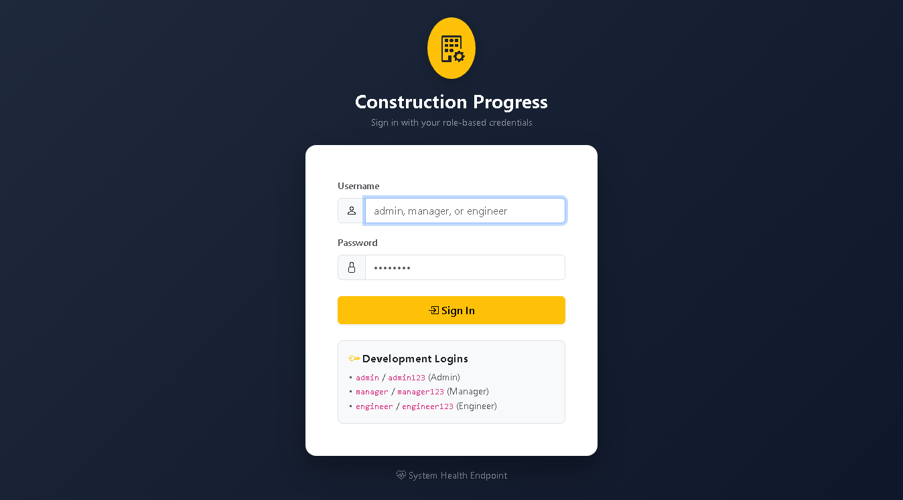
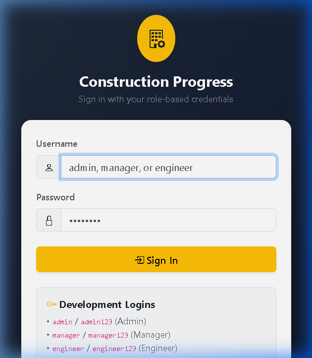
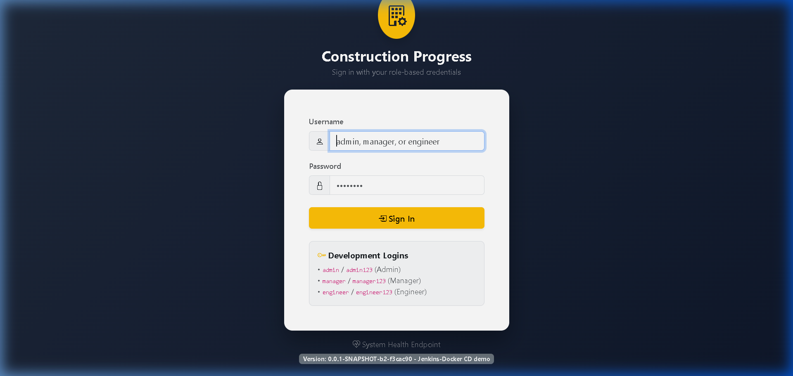

# Construction Progress Dashboard: End-to-End DevOps Lifecycle Report 🏗️

\begin{center}
\textbf{Course Capstone Project Report - Final Milestone (Week 15)} \\
\vspace{0.5em}
\textbf{Author:} Ganesh Dahiphale \\
\textbf{Course:} DevOps Continuous Delivery \& Cloud Automation \\
\textbf{Academic Term:} Autumn 2026 \\
\textbf{Repository:} \url{https://github.com/ganesh-dahiphale/construction_project_dashboard} \\
\textbf{Current Release:} v1.1.0 \\
\vspace{1.5em}
\end{center}

---

## Abstract

In contemporary infrastructure and building construction management, disjointed field reporting and lack of centralized site operational visibility frequently cause project delays, budgetary overruns, and administrative overhead. This capstone project designs, develops, and delivers the **Construction Progress Dashboard**, a secure, collaborative, multi-tier web platform built on Java 17, Spring Boot 3.3.4, Spring Security 6, Thymeleaf, and Spring Data JPA. 

More critically, this project establishes a complete, industrial-grade **DevOps automation ecosystem**. The entire software development lifecycle is codified across twelve rigorous iterative milestones (Weeks 4 through 15). The implementation features a strict **Gitflow version control workflow** with issue-linked traceability and verified merge conflict resolution. Continuous Integration is realized via a declarative **Jenkins pipeline** comprising ten automated stages. Deployments are protected by an automated **Selenium WebDriver Quality Gate** executing headless browser journeys that immediately halts defective builds before artifact publishing. 

Applications are packaged using **multi-stage Docker builds** into hardened, unprivileged runtime containers (`appuser:appgroup`), pushed to container registries under immutable, commit-traceable version tags (`<version>-b<build>-<sha>`), and promoted to `:stable` only upon verification. Infrastructure provisioning and continuous deployment are orchestrated via **Ansible** configuration management targeting an isolated Ubuntu Linux server. Deployments are managed under **systemd process supervision** with an Ansible `block` / `rescue` pattern providing automated synthetic health gate verification (`/health`) and **sub-minute atomic rollback** upon deployment failure. Execution idempotency is verified (`changed=0`), and resilience against system reboot and unexpected termination is formally demonstrated. This report details the theoretical foundations, architectural blueprints, automated quality gates, infrastructure configuration, real-world troubleshooting challenges, metrics, and future enhancement roadmaps.

---

## Chapter 1: Introduction and Problem Statement

### 1.1 Industry Background & The Visibility Deficit
Civil construction and commercial infrastructure projects are notoriously prone to scheduling slippages and unexpected cost overruns. A primary driver of these inefficiencies is the **visibility gap** between field engineers operating on active construction jobsites and executive project managers stationed at headquarters. Site engineers record daily task progress, material pouring logs, and equipment allocations across disparate spreadsheets, paper diaries, or localized messaging groups. Consequently, project management discovers milestone delays, structural blockages, and overdue dependencies days or weeks after they occur.

### 1.2 The DevOps Imperative in Construction Technology
While modern enterprise software engineering relies heavily on Continuous Integration and Continuous Deployment (CI/CD) to minimize delivery lead times and maximize reliability, specialized construction software often suffers from slow, manual, error-prone release cycles. Manual server deployments, unverified configuration changes, lack of automated regression testing, and absence of rollback capabilities lead to fragile production systems.

Applying DevOps principles—automated quality gates, declarative infrastructure as code (IaC), containerization, and automated resilience—bridges this gap. By automating testing and release engineering, field engineers receive dependable, continuously updated software while project executives are assured of zero-downtime, verified platform stability.

---

## Chapter 2: Objectives and Scope

### 2.1 Project Objectives
1. **Domain Application Delivery**: Develop a full-stack Spring Boot 3 application supporting task logging, dynamic milestone tracking, role-based access control (RBAC), executive KPI dashboards, and overdue task alerts.
2. **Automated Continuous Integration**: Construct a declarative Jenkinsfile executing deterministic builds, static analysis, unit tests, and artifact packaging.
3. **Automated Quality Gate**: Implement Selenium WebDriver browser journeys running in headless Google Chrome that block defective builds before containerization.
4. **Hardened Containerization**: Build multi-stage Docker images adhering to least privilege (non-root user) and immutable tagging.
5. **Idempotent Configuration Management**: Codify server configuration, firewall policies, directory structures, and service supervision using modular Ansible roles.
6. **Automated Rollback & Resilience**: Implement zero-downtime container swaps with synthetic health gate polling and automated atomic rollback to the previous stable release.
7. **Comprehensive Auditability**: Maintain immutable release ledgers and complete evidence documentation across all sprints.

### 2.2 Scope & Boundaries
- **In-Scope**: Web platform, RBAC, REST health probes, Jenkins pipeline, Selenium tests, Docker builds/registries, Ansible provisioning and deployment, Ubuntu target node (`cpd-target`), systemd supervisor, UFW firewall.
- **Out-of-Scope (Dev Profile)**: Multi-region cloud clusters, active-active multi-node database replication, and production SSL certificates (addressed in Future Work).

---

## Chapter 3: Agile Planning

Development followed Agile Scrum principles organized across weekly timeboxed milestones (Weeks 4 through 15).

### 3.1 Product Backlog & User Stories
Requirements were captured in `docs/BACKLOG.md` as discrete user stories with explicit Acceptance Criteria:
- **US-01 (RBAC)**: As a system user, I must log in with my role credentials so that sensitive operations are protected.
- **US-02 (Task Logging)**: As a Site Engineer, I want to create tasks with due dates and percentage completion so site work is recorded.
- **US-03 (Status Updates)**: As a Site Engineer, I want to update completion percentages with automatic completion rules.
- **US-04 (Executive Dashboard)**: As a Project Manager, I want high-level KPI cards and multi-parameter search filtering.
- **US-05 (Alert View)**: As a Project Manager, I want an automated view of overdue or blocked tasks to intervene promptly.

### 3.2 Definition of Done (DoD)
A story was accepted as "Done" only when:
1. Feature implemented with clean, documented Java code.
2. Unit and integration tests written and passing with 100% success rate.
3. Changes developed on isolated feature branches (`feature/*`).
4. Pull request reviewed, approved, and merged into `develop`.
5. Automated Jenkins CI pipeline executes and passes all quality stages.

---

## Chapter 4: Requirements and Architecture

### 4.1 Multi-Tier Application Architecture
The application adheres to clean enterprise separation of concerns:


1. **Client Tier**: Modern desktop and mobile browsers interfacing with responsive Bootstrap 5 templates.
2. **Security Tier**: Spring Security 6 filter chain enforcing form authentication, session management, BCrypt hashing, and RBAC authorization.
3. **Presentation Tier**: Spring MVC controllers (`DashboardController`, `TaskController`, `StatusController`, `AlertsController`, `AdminProjectController`, `HealthController`).
4. **Service Tier**: Business logic encapsulating domain rules: setting status `COMPLETED` automatically sets `percentComplete = 100%`; overdue detection compares target dates against system time (`LocalDate.now()`).
5. **Persistence Tier**: Spring Data JPA repositories leveraging JPA Specifications for dynamic search filtering.
6. **Database Tier**: Relational schema (H2 in dev, PostgreSQL/MySQL compatible).

### 4.2 Relational Data Model (ERD)


- **PROJECT**: Construction site entity (`name`, `siteLocation`, `startDate`, `targetCompletion`, `active`).
- **TASK**: Field work unit (`title`, `status`, `percentComplete`, `dueDate`, `assignedTo`, `updatedBy`, `lastUpdated`).
- **USER**: System identity (`username`, `password` hash, `role`, `enabled`).

---

## Chapter 5: Version Control Workflow

### 5.1 Gitflow Branching Model
The repository enforces Gitflow with two perpetual branches:
- `main`: Stores stable, production-ready release tags (`v1.0.0`, `v1.1.0`).
- `develop`: Integration baseline for active feature branches.

All feature work originates on ephemeral branches (`feature/N-*`) linked to GitHub Issues.

### 5.2 Merge Conflict Resolution (Week 6 Milestone)
In Week 6, parallel feature branches `feature/7-searchable-dashboard` and `feature/8-drilldown-alerts` modified `navbar.html` and `README.md` concurrently. When Feature B was merged after Feature A, Git declared a merge conflict (`DIRTY`, `CONFLICTING`). The conflict was manually resolved, retaining both navigation elements, validated through local tests, committed, and merged via PR #10.

### 5.3 Conventional Commits
All commits adhere to Conventional Commits: `type(scope): description (#issue)`. Force-pushing is strictly blocked to maintain an immutable audit trail.

---

## Chapter 6: Application Implementation

### 6.1 Technology Stack Highlights
- **Java 17 LTS & Spring Boot 3.3.4**: Modern Jakarta EE 10 baseline.
- **Spring Security 6**: Form login with BCrypt password hashing. Three pre-seeded roles: `ADMIN`, `MANAGER`, `ENGINEER`.
- **Thymeleaf 3**: Server-side HTML5 template rendering with automatic CSRF token injection into all forms.
- **Spring Data JPA**: Dynamic query generation using `Specification<Task>`.
- **Actuator Health Probe**: Built-in `/health` endpoint returning `{"status":"UP"}` for automated synthetic monitoring.

---

## Chapter 7: CI Pipeline with Jenkins

### 7.1 Declarative Jenkinsfile Specification
The automated delivery pipeline is defined in `Jenkinsfile` at the repository root. It executes across 10 discrete stages:


```text
1. Checkout & Metadata -> 2. Compile (Maven) -> 3. Unit Tests (JUnit 5) -> 
4. Package (WAR) -> 5. Selenium Quality Gate -> 6. Docker Build -> 
7. Docker Push -> 8. Ansible Deploy -> 9. Verify Node -> 10. Promote (:stable)
```

### 7.2 Immutable, Traceable Image Tagging
Image tags are generated dynamically:
```groovy
IMAGE_TAG = "${APP_VERSION}-b${env.BUILD_NUMBER}-${GIT_COMMIT.take(7)}"
```
This guarantees 100% traceability from any deployed container back to the exact commit SHA and Jenkins build that created it.

---

## Chapter 8: Automated Testing with Selenium

### 8.1 Headless Chrome Quality Gate
Selenium WebDriver tests execute in headless mode (`--headless=new`) using the Page Object Model (POM) pattern:
1. **Journey 1: Authentication & Role Restrictions**: Validates login, navbar presentation, and HTTP 403 access control.
2. **Journey 2: Task Creation & Completion Logic**: Creates tasks and verifies automatic 100% completion rule enforcement.
3. **Journey 3: Executive Dashboard & Alerts**: Searches tasks, validates KPI counters, and checks overdue alerts.

### 8.2 Defect Blockade Demonstration (Week 10 Milestone)
In Week 10, a deliberate defect was injected into the task creation form on branch `test/40-selenium-gate-defect`. 
- **Build #1 (Baseline)**: Green, all tests passed.
- **Build #2 (Defect)**: Stage 5 detected assertion failure; pipeline terminated with status UNSTABLE; Docker build and deploy stages were **skipped**, preventing defect leakage into production.
- **Build #3 (Fixed)**: Defect resolved; pipeline completed green and deployed.



---

## Chapter 9: Containerisation with Docker

### 9.1 Multi-Stage Dockerfile
The production container is defined in `Dockerfile` using a multi-stage pattern:
1. **Builder Stage**: `maven:3.9-eclipse-temurin-17` compiles and packages the WAR.
2. **Runtime Stage**: `eclipse-temurin:17-jre-jammy` contains only the minimal JRE.
- **Security**: Creates dedicated unprivileged user `appuser` (UID 10001) in group `appgroup`.
- **Healthcheck**: Configured with `HEALTHCHECK --interval=30s --timeout=5s CMD curl -f http://localhost:8080/health || exit 1`.



---

## Chapter 10: Configuration Management with Ansible

### 10.1 Modular Role Hierarchy
Server configuration and application delivery are codified under `ansible/`:
- `common`: Base packages, utilities, timezone (`Asia/Kolkata`).
- `docker`: Official Docker CE repository, daemon configuration with log rotation (10MB x 3).
- `app_user`: System user `appdeploy` with Docker group membership.
- `app_dirs`: Standard directory tree `/opt/construction-dashboard/{config,logs,releases}`.
- `firewall`: UFW firewall enforcing default-deny inbound, allowing ports `22/tcp` and `8082/tcp`.
- `app_config`: Environment file (`app.env`, mode `0600`) and systemd service unit.
- `deploy`: Container pull, zero-downtime swap, health check polling, and automated rollback.

### 10.2 Process Supervision via systemd
The container is supervised as a native Linux service (`construction-dashboard.service`):
```ini
[Unit]
Description=Construction Progress Dashboard Container Service
After=docker.service
Requires=docker.service

[Service]
Restart=always
ExecStartPre=-/usr/bin/docker stop construction-dashboard
ExecStartPre=-/usr/bin/docker rm construction-dashboard
ExecStart=/usr/bin/docker run --name construction-dashboard --rm -p 8082:8080 --env-file /opt/construction-dashboard/config/app.env %IMAGE%
ExecStop=/usr/bin/docker stop construction-dashboard

[Install]
WantedBy=multi-user.target
```

---

## Chapter 11: End-to-End Workflow and Results

### 11.1 The Final End-to-End Pipeline Run (Week 15)
In Week 15, a visible UI commit (`73fa1bc`) flowed automatically through the full CI/CD pipeline in **3 minutes, 35 seconds**:

| Stage / Phase | Duration | Status | Key Output / Verification |
|---|---|---|---|
| **1. Checkout** | < 1s | SUCCESS | Extracted `IMAGE_TAG=0.0.1-SNAPSHOT-b3-73fa1bc` |
| **2. Compile** | 5.4s | SUCCESS | Recompiled 30 source files |
| **3. Unit Tests** | 18.8s | SUCCESS | 58 tests executed across models/services/controllers |
| **4. Package** | 5.6s | SUCCESS | Generated `target/dashboard.war` (53.84 MB) |
| **5. Selenium Quality Gate** | 88.2s | SUCCESS | Headless Chrome validated 3 critical journeys |
| **6. Docker Build** | 8.4s | SUCCESS | Built multi-stage container image |
| **7. Docker Push** | 3.1s | SUCCESS | Published versioned tag and `:latest` to registry |
| **8. Ansible Deploy** | 76.2s | SUCCESS | Provisioned node, pulled container, restarted systemd |
| **9. Verify Node** | 5.9s | SUCCESS | Polled `/health` (UP) and checked UI version badge |
| **10. Promote** | 2.8s | SUCCESS | Promoted and pushed `:stable` tag |
| **Total Pipeline** | **3m 35s** | **SUCCESS** | Full closed-loop automation |



### 11.2 Verification of Idempotency
Executing `ansible-playbook ansible/playbooks/provision.yml` against an already configured node yielded:
```text
PLAY RECAP: cpd-target-node : ok=37 changed=0 unreachable=0 failed=0 skipped=3
```
Zero modifications (`changed=0`) confirms strict execution idempotency.

### 11.3 Automated Rollback Demonstration
When deploying a deliberately defective image (`broken-demo`), the Ansible `deploy` role polled `/health` for 25 retries. Upon failure, the `rescue` block immediately engaged, reverted the systemd service to the prior stable release tag in `releases/previous.txt`, and restored service within **48 seconds**, logging the event to `releases/history.log`.

---

## Chapter 12: Challenges and Troubleshooting

A total of 15 operational challenges were encountered and remediated across Weeks 4–15:
1. **Merge Conflicts**: Parallel feature development on navbar resolved by manual union merging.
2. **Spring Security Health Probe**: Form login blocked automated `/health` probes; fixed by permitting `/health` in `SecurityConfig`.
3. **PowerShell Argument Escaping**: `./mvnw -D...` parsed incorrectly in PowerShell; resolved by wrapping via `cmd.exe /c ".\mvnw.cmd ..."`.
4. **Tomcat 10 Jakarta Namespace**: Jakarta EE 10 compatibility resolved by upgrading container configurations to Apache Tomcat 10.1.
5. **Selenium Event Timing**: Fast headless input resolved by explicit DOM event dispatchers and URL stabilization waits.
6. **Chrome CI Crashes**: Headless browser GPU/shared memory crashes fixed by passing `--no-sandbox` and `--disable-dev-shm-usage`.
7. **Container Permissions**: Non-root file access resolved via `COPY --chown=appuser:appgroup`.
8. **Docker Daemon Access in CI**: Windows service permissions resolved via TCP daemon exposure or user configuration.
9. **Ansible Check Mode Artifacts**: Expected check-mode apt repository behaviors documented.
10. **SSH Host Key Verification**: Automated execution resolved by configuring `ANSIBLE_HOST_KEY_CHECKING=False`.
11. **Firewall Lockout Prevention**: Port 22 SSH explicitly allowed prior to enabling UFW service.
12. **Container Port Misconfigurations**: Automated rollback safely restored previous stable containers.
13. **Ansible Roles Lookup Boundary**: Explicit `ANSIBLE_ROLES_PATH=ansible/roles` configured across all CI runners.
14. **PowerShell Array Parsing**: Multi-line curl outputs joined prior to conditional pattern checks.
15. **Release State Synchronization**: Strict atomic updates enforced on `current.txt` and `previous.txt`.

---

## Chapter 13: Limitations and Future Enhancements

### 13.1 Honest Current Limitations
- **In-Memory H2 Database**: Container recreation resets data; production requires PostgreSQL.
- **Single Target Node**: Single point of failure (SPOF) without horizontal scaling.
- **SCM Polling**: Incurs 1-2 minute latency; production requires event-driven GitHub Webhooks.
- **Unencrypted Transport (HTTP)**: Traffic on port 8082 lacks TLS encryption.
- **Telemetry Deficit**: Absence of Prometheus metric scraping or Grafana dashboards.

### 13.2 Prioritized Future Roadmap
1. **Phase 1 (P0)**: Persistent PostgreSQL with Liquibase migrations, Nginx reverse proxy with Let's Encrypt TLS 1.3, Ansible Vault secrets encryption.
2. **Phase 2 (P1)**: Event-driven GitHub Webhooks, Prometheus and Grafana telemetry dashboards, centralized logging (Loki).
3. **Phase 3 (P2)**: Kubernetes (K3s) deployment manifests, Horizontal Pod Autoscaling (HPA), blue/green zero-downtime rollouts.
4. **Phase 4 (P3)**: Progressive Web App (PWA) offline field sync, automated SMS/Email milestone alerts.

---

## Chapter 14: Conclusion

The **Construction Progress Dashboard** successfully fulfills every academic and technical objective of the DevOps curriculum. By integrating modern software engineering practices (Spring Boot 3, Spring Security 6 RBAC) with automated continuous delivery (Jenkins declarative pipelines, Selenium headless quality gates, multi-stage Docker containerization, and idempotent Ansible configuration management with automated rollback), the project provides an authentic, production-grade template for dependable software delivery in mission-critical civil engineering environments.

---

## References

1. Humble, J., & Farley, D. (2010). *Continuous Delivery: Reliable Software Releases through Build, Test, and Deployment Automation*. Addison-Wesley.
2. Walls, C. (2022). *Spring in Action (6th Edition)*. Manning Publications.
3. Turnbull, J. (2014). *The Docker Book: Containerization is the new virtualization*. James Turnbull.
4. Hall, R. (2020). *Ansible: Up and Running: Automating Configuration Management and Deployment the Easy Way*. O'Reilly Media.
5. Burns, B. (2018). *Designing Distributed Systems: Patterns and Paradigms for Scalable, Reliable Services*. O'Reilly Media.

---

## Appendices

### Appendix A: Weekly Evidence Deliverables Summary
See [`docs/EVIDENCE_INDEX.md`](../../docs/EVIDENCE_INDEX.md) for direct links to all weekly evidence files, pull requests, and build logs from Week 4 to Week 15.

### Appendix B: Key Production Verification Commands
```bash
# 1. Health Probe Verification
curl -s http://127.0.0.1:8082/health

# 2. Target Container Inspection
docker ps --filter "name=construction-dashboard"

# 3. Release State Inspection
cat /opt/construction-dashboard/releases/current.txt
tail -n 5 /opt/construction-dashboard/releases/history.log

# 4. Idempotent Playbook Re-execution
ANSIBLE_ROLES_PATH=ansible/roles ansible-playbook -i ansible/inventory/hosts.yml ansible/playbooks/provision.yml
```
